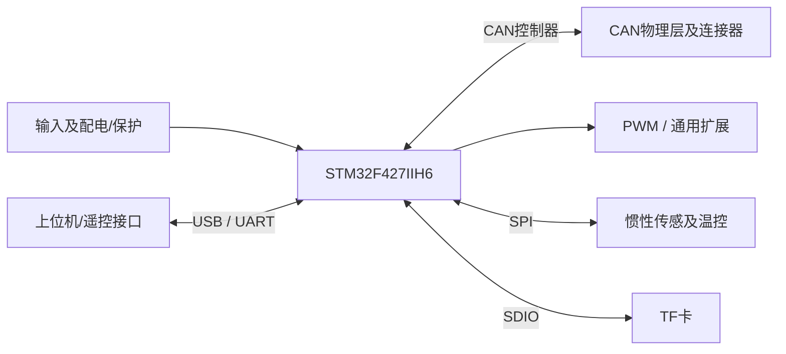

# DJI-A型 硬件架构

整理：2026-10-11。依据本目录原理图及说明书重建的功能视图；不是厂商原始架构图，也未做实物验证。板卡定位：**机器人接口与配电组织参考**。

| 模块 | 原理图/手册观察 |
| --- | --- |
| MCU | STM32F427IIH6 |
| CAN | 2 路经典 CAN，10 个插座按 6+4 并接 |
| IMU | MPU6500/IST8310（按官方手册；图纸文字与BOM需对应版本确认） |
| 存储 | TF/SDIO |
| 通信扩展 | USB、多 UART、遥控/蓝牙接口 |
| PWM | 16 路可调供电PWM + 4 路无供电PWM（手册口径，共享时基需核查） |
| 电源 | 多电压配电、PWM电源档位、分支输出及保护 |

## 对本工程的意义

借鉴接插件分组、总线归属标记及配电分区；新核心不沿用其两CAN资源或整板功率规模。

证据边界：10页原理图的第三方镜像 + 35页官方手册；未获得可编辑EDA/BOM/PCB。原理图页签2～11/11，不能宣称原始11页工程齐全。

电流额定、共地/隔离、热设计、时序与停止行为需绑定实物和版本；本图不表示这些性能已经验证。详细页码、疑点和采用条件见[总结分析报告](总结分析报告.md)；图纸见[原理图索引](原理图/README.md)，来源见[来源说明](资料/来源说明.md)。
