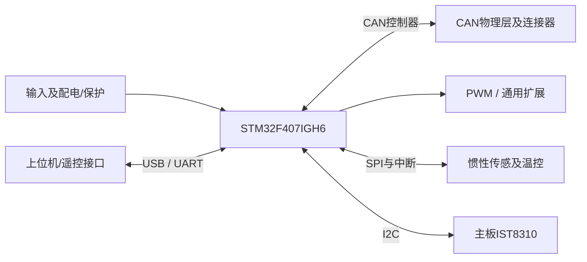

# DJI-C型 硬件架构

整理：2026-10-11。依据本目录原理图及说明书重建的功能视图；不是厂商原始架构图，也未做实物验证。板卡定位：**紧凑控制板与IMU分区参考**。

| 模块 | 原理图/手册观察 |
| --- | --- |
| MCU | STM32F407IGH6 |
| CAN | 2 路经典 CAN，4 插座分为 2+2 |
| IMU | BMI088 独立FPC小板 + 主板IST8310 |
| 存储 | 未见板载TF或外部NOR |
| 通信扩展 | USB、UART1/6、USART3 DBUS、SPI2、I²C2、DCMI |
| PWM | TIM1 CH1～4 + TIM8 CH1～3，共7路 |
| 电源 | 8～28V输入规格，逻辑/外设/PWM支路，FPC加热 |

## 对本工程的意义

借鉴小型接口分组与IMU热/机械分区；不复制仅两路经典CAN。原理图电源框图中TJA1044的表达应以详细CAN电路为准，VIO不是3.3V输出。

证据边界：官方主板原理图7页、主板位号图、IMU FPC原理图1页及位号图、21页官方手册；未获得原生EDA、PCB走线或生产BOM。

电流额定、共地/隔离、热设计、时序与停止行为需绑定实物和版本；本图不表示这些性能已经验证。详细页码、疑点和采用条件见[总结分析报告](总结分析报告.md)；图纸见[原理图索引](原理图/README.md)，来源见[来源说明](资料/来源说明.md)。
