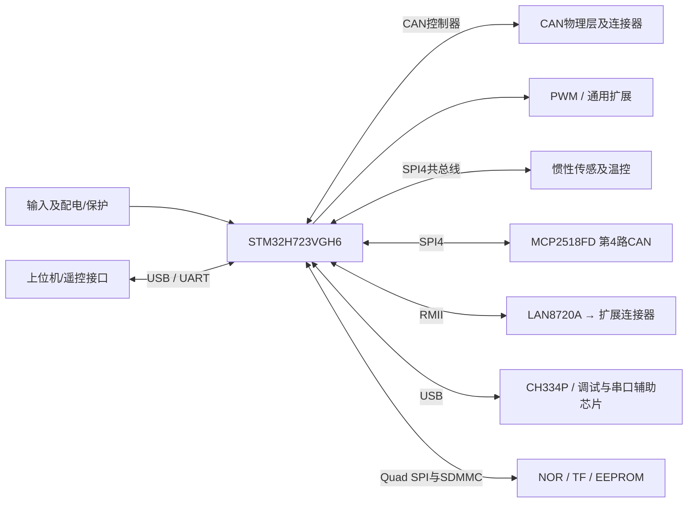

# D_MAIN_2558 硬件架构

整理：2026-10-11。依据本目录原理图及说明书重建的功能视图；不是厂商原始架构图，也未做实物验证。板卡定位：**用户提供的高集成BGA方案参考**。

| 模块 | 原理图/手册观察 |
| --- | --- |
| MCU | STM32H723VGH6 |
| CAN | 3 原生 FDCAN + SPI4 外挂 MCP2518FD 第4路 |
| IMU | BMI088 + FDI-Delta10模块，后者接CAN3不是额外控制器 |
| 存储 | W25Q128JVPIQ、24C02 EEPROM、4-bit TF |
| 通信扩展 | LAN8720A RMII、RS-485、CH334P USB HUB、F072调试器、CH343P |
| PWM | 按MCU与Connectors图纸复核扩展；不按符号数量承诺完整定时器组 |
| 电源 | TPS26600输入保护、MP4423A降压、TPS25942/259460分支、TPS2553 USB保护 |

## 对本工程的意义

借鉴BGA核心、存储与保护分层；不直接复制5V保护旁路、共SPI调度、以太网缺失前端和板载调试器部分。JLink-OB只是图纸意图，授权与固件来源未确认。

证据边界：用户原始7个DXF完整复制并有PNG/文字坐标预览；无原生EDA、网表/ERC、完整BOM、PCB或固件。DXF中的连线/交叉不能替代网表。

电流额定、共地/隔离、热设计、时序与停止行为需绑定实物和版本；本图不表示这些性能已经验证。详细页码、疑点和采用条件见[总结分析报告](总结分析报告.md)；图纸见[原理图索引](原理图/README.md)，来源见[来源说明](资料/来源说明.md)。
