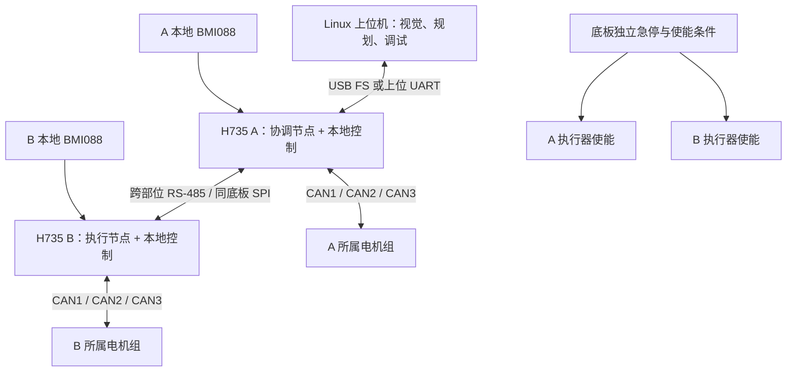

# H735 多 MCU 协作与验证方案

> 后续工程已采用[v0.9规划](../工程规划/README.md)：IMU改用SPI4，SPI3 MOSI改PB2，CAN收发器移入核心。本文v0.8引脚/接口建议保留为历史分析；协议、任务和验证方法继续适用。

2026-10-13。面向 RM 通用控制板，继续采用 STM32H735VGH6、Direct SMPS 和现有 STM32／FreeRTOS 软件路线，同时支持同底板安装与机器人不同部位的线束连接。

**首版建议使用两块相同的 H735 核心板，各自控制本地电机；跨部位用专用 RS-485 链路，同底板增加 SPI 通信配置。**两种传输共用指令、状态、时间和故障语义。先验证 RS-485 双节点，再验证 SPI，避免同时调试两套协议。若只需要合计四路电机 CAN，独立 CAN FD 板间总线也是可选的简化路线。

当前工程有完整的接口规划，但还没有正式 EDA、可构建应用固件或实物测试结果。本文中的速率、时间上限与容量都是设计预算或样机验收目标；现有引脚 CSV 与供电连接保持不变，SPI 引脚调整在本文单列，待形成下一版硬件输入。

## 工程资源与实际约束

依据：[需求基线](../需求基线.md)、[引脚规划](../引脚规划.md)、[连接器 CSV](../数据/板间接口_J1_J2_草案.csv)、[板间电气约定](../板间接口规范.md)、[固件架构](../固件架构.md)、[外围器件](../外围器件选型.md)。

| 当前资源 | 对多 MCU 的意义 | 需要处理的约束 |
| --- | --- | --- |
| 每板 3 路独立 FDCAN | 两板有 6 个 CAN 控制器，可各自连接本地电机总线 | 若每板拿一路做共享板间 CAN，只剩合计 4 路独立电机总线 |
| 设备 UART1～4，各有 TX/RX/DIR | 可将一组配置为半双工 RS-485 板间口 | 占用一个设备串口后，每板只剩 3 组设备 UART；不能宣称四组仍可给其他设备同时使用 |
| UART8 上位备用、UART7 辅助 | 可继续用于上位或接收机等独立用途 | 两组都没有当前已分配的 DIR；不能直接按现有接线驱动半双工 RS-485 |
| SPI3 的 SCK/MISO/MOSI/CS 已引出 | 适合短距离同底板通信，不占 CAN | CS 为 PE4 普通 GPIO；PE4 无 SPI3_NSS 复用，当前接法不能直接用硬件 NSS 从机 |
| BMI088 独占 SPI1 | IMU 采样无需与板间 SPI3 争用总线 | PA15 已作为 IMU 第二片选，而它恰好可复用 SPI3_NSS |
| PB1、PE10 两个预留信号 | 可作为 SPI READY 与同步/测时信号 | 需要更新角色、电气和 EXTI 分配；目前不承诺已支持这些功能 |
| USB 内置 FS PHY，当前 Device 配置 | 适合 Linux 上位机连接协调板 | 两个当前配置的 USB Device 不能直连通信；12 Mbit/s 不是应用有效吞吐或确定时延保证 |
| 未规划 RMII 与 PHY | 当前方案无需承担以太网硬件和协议栈改造 | H735 有 MAC 不等于当前板已有以太网；RMII 涉及已占用引脚，不能只补一个插座 |

两块板是两个独立调度、内存和故障域，不会自动成为共享 RAM 的双核系统。硬件相同，固件按配置分配“协调节点”和“执行节点”角色，底板按安装位置裁剪收发器、供电和连接器。

## 板间通信选择

| 方案 | 适用位置 | 两板可保留的电机 CAN | 当前工程改动与开发负担 | 建议 |
| --- | --- | --- | --- | --- |
| UART + 半双工 RS-485 | 同底板，也可跨部位线束 | 6 路 | 底板装已有候选 THVD1450；占用各板一个设备串口；实现轮询、CRC、期限与方向切换 | 首版通用方案 |
| SPI3 + DMA + READY | 同底板或很短的板间连接 | 6 路 | 需要 NSS 引脚修订、主从状态机和掉电处理；吞吐余量较大 | 第二阶段短距离方案 |
| 独立 CAN FD 骨干网 | 线束连接、多节点 | 4 路 | 复用 CAN 驱动与物理层；需 ID、分片、优先级及总线负载规划 | 四路电机 CAN 足够时可选 |
| 以太网或 EtherCAT | 更大规模、强耦合多轴系统 | 取决于重新规划 | 新 PHY/接口或 EtherCAT 从站硬件、引脚和协议栈工作较多 | 当前版本不作为验证起点 |

RS-485 首版采用专用点对点链路。只有协调节点可以发起事务，执行节点按地址和时隙应答；不允许两个节点主动抢发。RS-485 本身不提供 CAN 式仲裁、重传和业务确认，这些能力需要应用层设计。多节点时只能按线型主干和短支线连接，不能把多条长分支并成被动星形；也可以使用多个独立 UART 形成点对点星形，但会继续占用协调板的设备口。[TI RS-485 设计指南](https://www.ti.com/lit/an/slla272d/slla272d.pdf)

CAN FD 骨干必须与只支持经典 CAN 的电机总线分开。两块 H735 的 CAN3 接同一骨干后，它们构成一条共享物理总线，而不是两条新增电机总线。N 块板各拿一路做骨干时，剩余 2N 路独立电机 CAN；改用串口或 SPI 板间通信时，理论上可保留 3N 路，实际仍受各链路与控制任务预算限制。

## RS-485 在现有板上的连接

建议将产品设备口 UART4 配置为 BOARD_LINK，实际外设也是 UART4。选择它是为了给出一个明确且不挤占 UART8／UART7 的初始配置，并不表示它比其他设备 UART 更快。

| 核心连接 | MCU 引脚 | 底板接法 |
| --- | --- | --- |
| J1-25，UART4_TX | PD1，AF8 | THVD1450 的 D 输入 |
| J1-26，UART4_RX | PD0，AF8 | THVD1450 的 R 输出 |
| J1-27，UART4_DIR | PD15，GPIO | DE 与低有效接收使能 /RE 联动：低为接收，高为发送 |
| J1-28，GND | 地 | 逻辑回流；非隔离线束另外安排参考地 |

THVD1450 是工程已有候选，支持半双工及最高 50 Mbit/s 器件信号速率，但不代表 H735 UART、线束和整板能够在该速率下工作。首轮目标为 3 Mbaud，进阶验证 6 Mbaud；先核 UART 内核时钟、分频误差、过采样、DMA 和接收裕量，再确定实用速率。[TI THVD1450](https://www.ti.com/product/THVD1450)

底板接口采用 A/B 双绞线与参考地，防呆连接器、接口保护和可配置终端。按线缆特性阻抗在物理两端终端匹配，常见 120 Ω 线缆为两端各 120 Ω，中间节点不逐个加终端；偏置集中设计并计入驱动负载。线长、支线、地电位差或噪声超出非隔离方案能力时，增加隔离收发器及其隔离电源，重新验证时延与速率。

DIR 必须等 UART TC、最后一个停止位真正发送完，再释放；DMA 完成不能代替 TC。接收 DMA 在对方回复前就绪，应答超时直接结束当前事务，不能阻塞本地控制。优先采用固定长度上限、显式长度与 CRC 的帧解析，空闲中断只辅助唤醒，不能单独作为完整帧依据。

如果四组设备 UART 都必须留给外设，可另评 UART8 加预留 GPIO 作为 DIR 的专用板间配置；代价是占用上位串口备份与一个预留脚。首版采用 UART4，避免同时维护多种互斥引脚用途。

## 同底板 SPI 的引脚修订建议

对精确 TFBGA100 封装与 AF XML 的复核结果：PA15/C8 支持 SPI3_NSS、AF6，PE4/C3 不支持。当前 BMI088 第二片选只需要普通 GPIO，可以用下面的信号交换保留全部功能，不增加 MCU 焊盘数。

| 信号 | 当前 v0.8 | 建议下一版 | 外部影响 |
| --- | --- | --- | --- |
| EXP_SPI_CS | PE4/C3，J2-13 | PA15/C8，仍为 J2-13 | 主机配置为 GPIO 片选输出，从机配置为 SPI3_NSS AF6 输入 |
| IMU_SECOND_CS | PA15/C8，本地 | PE4/C3，本地 | BMI088 第二片选改线，保持上拉及默认未选中 |
| SPI3 SCK/MISO/MOSI | PB3/PB4/PB5，J2-9/11/12 | 不变 | PB5 的 MOSI 仍是 AF7；SCK/MISO 为 AF6 |
| READY | PB1/K5，J2-31 预留 | 从机输出、主机输入 | 底板接收端下拉，未上电/未准备好时为低；可用 EXTI1 |
| 可选 SYNC | PE10/H6，J2-33 预留 | 主机输出、从机输入 | 可用 EXTI10；首次可只作测时点 |

来源：[H735 封装 XML](../技术依据/compact-mcu-review/STM32H735VGHx.xml)、[AF XML](../技术依据/pin-resource-review/GPIO-STM32H72_gpio_v1_0_Modes.xml)。当前 EXTI3/4/5/6/9 已分配；PB1/PE10 不与它们冲突。这里的同步输入是 GPIO/EXTI 候选，不声称已有硬件定时器捕获精度。

正式采用前应同步修改 75 信号表、100 球表、J2 CSV、IMU 接法、BSP 与上拉/复位状态；本次没有直接改这些基线文件。两个板的主从方向必须由配置明确，不能将两个片选输出或两个 READY 输出相连。普通 GPIO 片选配软件 NSS 可做受控实验，但复位和失步恢复更依赖软件，不作为首版通用从机方案。

首版 SPI 只接一个从节点，选短连接和连续地回流；约 10 cm 以内只是最初台架条件，不是已验证线长指标。主机 SCK/MOSI/NSS 与从机 MISO 的驱动端预留串联阻尼位，阻值按波形调整；校核单板掉电时的 IO 反灌。不能将普通 3.3 V SPI 延伸到机器人长线束。

从机先准备 TX 快照和 RX DMA，再拉高 READY；主机检测就绪后拉低 NSS 并传输固定 128 字节。MISO 返回的是预先准备的状态或上一事务结果，不能要求从机在同一个全双工帧里先收到整包命令、处理完，再返回该命令的最终确认。命令是否真正应用，通过后续状态中的序号/时间确认。READY、NSS、DMA 和超时构成明确的状态机，任一方复位后清空半帧并重新握手。[ST AN5543](https://www.st.com/resource/en/application_note/an5543-enhanced-methods-to-handle-spi-communication-on-stm32-devices-stmicroelectronics.pdf)

关闭 SPI 硬件 CRC、使用应用 CRC，也不代表可以忽略 SPI 勘误。需按实际芯片修订落实 ES0491 中 CRCSIZE、EOT 后输出截断、传输停滞等适用规避措施，示波器检查首尾时钟与 NSS 保持时间。[ST ES0491](https://www.st.com/resource/en/errata_sheet/es0491-stm32h72xx73xx-device-errata-stmicroelectronics.pdf)

## 两块板的任务分配

| 任务 | 协调节点 A | 执行节点 B |
| --- | --- | --- |
| 机器人模式、遥控器、裁判系统、上位目标 | 统一输入仲裁、模式与配置版本 | 接收有效的模式、限幅和本地目标 |
| 整机耦合计算 | 放在 A 或具有相应实时能力的上位平台，并测量完整反馈往返 | 提供有时间戳的必要状态，不重复进行相互冲突的整机决策 |
| 电机反馈与局部闭环 | 管理自己的 CAN 和电机、执行本地闭环 | 管理自己的 CAN 和电机、执行本地闭环 |
| IMU 采样与姿态 | 使用 A 所在刚体的传感器与标定 | 使用 B 所在刚体的传感器与标定；云台和底盘姿态不能直接混为一个坐标系 |
| 时间与控制权 | 提供协调时基和唯一控制会话 | 校验序号、时效、控制权和同步质量 |
| 故障与使能 | 管理整机联锁，同时处理本地故障 | 独立检测本地超时与故障；不能等待 A 告知自己该停机 |
| 日志与维护 | 汇总摘要、低优先级传给上位 | 本地环形日志、限流上传；更新只在停机维护态进行 |

RM 轮式机器人可按“底盘电机组”和“云台/发射机构”分配，让传感器与其反馈闭环在同一板。多关节机器人则按同一机械链或强耦合关节组分配，避免同一个高频位置/速度环横跨两块 MCU。电流环/FOC 若由智能驱动器内部执行，H735 下发目标；不能把增加 H735 等同于获得了直接驱动裸电机的功率级。

十二关节的起始例子是 A、B 各管理六个关节，各板三路 CAN、每路两个关节。假设每关节每周期各一帧 8 字节命令和反馈、每帧按约 130 bit 预算，经典 CAN 1 Mbit/s、1 kHz 时每路约 52% 占用；这是估算，具体协议的扩展 ID、位填充、周期反馈及重传必须重新计入。若各板占一路 CAN 做骨干，每路三个关节的同类估算约 78%，余量明显减少。

多 MCU 不能消除全身控制对跨板反馈的需要。如果 A 计算全身力矩，B 必须上传所需关节状态及采样时间，A 再下发带生效时间的目标；链路往返和状态年龄进入稳定性分析。500 Hz 板间目标配 1 kHz 本地环只表示可插值或保持目标，不等于 1 kHz 全身控制。平衡、跳跃等任务需要更严的整机实测；不要用“本地闭环还在跑”代替整体稳定性结论。

## 统一协议与故障语义

先实现一个固定上限的协议，再分别包装到串口和 SPI。每条命令包含版本、源/目的节点、控制会话、序号、配置版本、模式、目标生效时间、有效期限、有效载荷长度及应用 CRC。明确字节序、单位、坐标系、浮点表示与范围，拒绝 NaN/Inf 和越界值；不直接传输未定义填充的 C 结构体。

用于带宽计算的初始帧为 128 字节：28 字节头部、最多 96 字节载荷、4 字节 CRC。头部可分配为版本/type/src/dst 各 1 字节、session/seq/sample_time/execute_time 各 4 字节、TTL/length/flags/config_epoch 各 2 字节。六个关节每个 16 字节记录正好占 96 字节；命令记录可含 ID、模式、标志及位置/速度/力矩，反馈记录可含 ID、状态、错误及位置/速度/力矩。增益、温度、详细故障等通过低频消息传递；这只是拟定格式，新增字段必须重新计入预算。

串口采用 COBS 等有明确恢复边界的封装；按 COBS 计算，128 字节解码帧最多对应 129 字节编码数据加 1 字节分隔符。SPI 按固定 128 字节传输，不需要相同的串口边界开销。配置消息可应答重试，周期控制使用最新有效目标，过期重传不能挤压新目标。CAN FD 迁移时需将 128 字节消息分片，只有版本、序号、长度和 CRC 全部通过后才能一次提交，不能按到达的半包驱动电机。

运行状态为 BOOT → DISARMED → READY → ARMED；错误进入 FAULT。READY 表示资源和配置就绪，不表示允许输出。首次启动、任一节点复位、会话变化、严重失步及链路切换均撤销使能，清空旧队列，重新握手和显式解锁。首版只启用一种控制传输，不做 SPI/RS-485 双链路自动无缝接管，防止双重控制权。

控制超时以最后一条通过校验且仍在有效期内的目标计算；心跳或配置流量不能延长旧目标寿命。节点本地故障先处置，再向协调节点报告；相关机械链通过明确联锁停机。不同执行器分别定义失联后的限流、减速、零力矩或制动策略，重力承载关节不能一概瞬时断力。独立急停路径须同时作用于两侧底板使能，软件通信仅报告状态。

## 时间同步与 FreeRTOS 实现边界

两板各用连续运行的微秒级计时器给 IMU、CAN 接收和目标应用打时间戳，本地控制由定时器触发或确定性通知驱动，不能靠串口包到达触发整个控制环。跨板定义协调时基，采用请求/应答时间戳估计偏移和漂移，记录往返时延并拒绝异常样本；DMA 完成或任务唤醒时间与线上的首位时刻不同，需要校正或计入误差。

目标提前发送，带 execute_at，由各板转换为本地时刻执行；过晚则丢弃并计数。初始可采用约 2 ms 提前量，再按测得的链路延迟及控制稳定性调整。同底板可以加 SYNC 脉冲改善测时，但仍需测 EXTI 延迟，不能把它等同于硬件同步采样。32 位微秒时间约 71.6 分钟回绕，比较使用有界模差、限定期限小于半个回绕周期，并将回绕与节点重启分别处理；节点重启要更新会话。

FreeRTOS 的建议顺序是：短 ISR 采样/搬运和故障通知 → 本地控制与期限判断 → 链路 DMA/解析及目标快照交换 → 状态发布 → 存储、显示与维护。中断调用 RTOS API 时遵守所选端口的最大系统调用中断优先级；控制任务不等待 USB、TF、NOR 或对端回复。各电机反馈只保留最新快照，控制目标队列有界，配置与日志使用独立低优先级队列。

UART/SPI DMA 缓冲放入所用 DMA 能访问的 SRAM；采用不可缓存区域，或按 32 字节 cache line 对齐和正确清理/失效，同时保证 DMA 与 CPU 不并发修改同一缓冲。初始建议在 DMA 可访问 SRAM 中划定约 8 KiB 非缓存通信区域，最终按 map 文件、队列和栈水位核定。不能默认把 DMA 缓冲放入 DTCM，也不能用关闭全部 cache 作为最终性能验证。三路 FDCAN 的消息 RAM 分区另行核对，复制单路初始化时必须检查偏移与容量。[ST AN4839](https://www.st.com/resource/en/application_note/an4839-level-1-cache-on-stm32f7-series-and-stm32h7-series-stmicroelectronics.pdf)

## 带宽与实时预算

以下是一条 A↔B 链路的计算：每周期命令和反馈各 128 字节解码帧；RS-485 按 8N1、每方向 130 字节在线数据、每周期合计 40 µs 方向转换/处理空隙预算。40 µs 是待测输入，尚未证明固件能达到。

| 传输 | 双向每周期串行化及假定间隙 | 500 Hz 占用 | 1 kHz 占用 | 判断 |
| --- | --- | --- | --- | --- |
| RS-485，3 Mbaud | 906.7 µs | 45.3% | 90.7% | 首轮 500 Hz；不作为 1 kHz 目标档 |
| RS-485，6 Mbaud | 473.3 µs | 23.7% | 47.3% | 可作为 1 kHz 候选，须验证实际波特率、线束和处理时延 |
| SPI，10 MHz，全双工 128 字节 | 102.4 µs，不含 READY/NSS 间隙 | 5.12% | 10.24% | 短距离吞吐有余量，实际更新仍包含 DMA/任务和流水线延迟 |

串口时间公式为 `260 × 10 / baud + gap`；SPI 为 `128 × 8 / SCK`。上述占用不含配置、时钟同步、详细故障、日志、错误恢复及非预期排队。SPI 的状态是预先准备的快照，不能把 102.4 µs 写成“当前命令到应用再到确认”的往返延迟。

增加一个相同执行节点时，半双工共享总线轮询负载近似加倍：6 Mbaud、两个执行节点、每节点 1 kHz 已约 94.7%，不适合继续叠加。可降频、压缩实际需要的状态、拆成独立 UART 链路，或改用同底板 SPI 多从机/后续高速骨干；不能从 THVD1450 的最大节点数推断实时容量。

## 供电与故障隔离

两块核心板各自接受受保护的 5 V 供电。当前单板 1.5 A 是入口设计预算，两板配电先按合计 3 A 核心预算另加底板和外设负载评审；这不是预测每板实际耗电。不能从一块板合计仅 200 mA 预算的 3V3_AUX 给另一块板供电，也不能并联两个独立 3.3 V 稳压器输出。

同底板采用分支保护与独立测流点；跨部位可在各底板就近降压，明确地参考及隔离边界。两板 PWR_EN 必须分别进入本地使能逻辑，不能把两个推挽输出硬连。系统急停作用于两侧的独立禁止路径，ESTOP_N/BASE_FAULT_N 的断线默认禁止约定继续保留。停机通信、CAN 待机和真正切断执行器使能是不同动作，逐一验证；只有停止发送并不能保证所有电机立即停止。

多板增加接口数量与局部故障隔离，但协调板、公共电源和共享线束仍可能成为单点故障。首版按故障可检测、可停止设计，不宣称冗余容错控制。

## 分阶段验证与退出条件

先用现有 H723 板验证协议和任务分层，再在 H735 上验证 Direct SMPS、DMA/cache 和并发性能；H723 上的通过结果不能代替 H735 的电源或精确封装验证。若缺少 H735 样机，可用官方 STM32H735G-DK 做外设行为验证，它采用 H735IGK6，仍需按开发板原理图确认可用引脚，不能直接验证本项目 VGH6 的接线和尺寸。[ST 开发板说明](https://www.st.com/en/evaluation-tools/stm32h735g-dk.html)

| 阶段 | 具体操作 | 记录和退出条件 |
| --- | --- | --- |
| V0 配置闭合 | 锁定芯片修订、CubeH7/HAL/FreeRTOS、时钟树、引脚、DMA/DMAMUX、内存域、任务优先级；按 ES0491 审核外设配置 | 生成 .ioc、链接 map、端口所有权表及勘误检查表；资源冲突必须关闭 |
| V1 单板基准 | H735 首上电、Direct SMPS/时钟恢复；一条 CAN 实设备、BMI088、定时本地环；再启用三 CAN | 电源波形、温升、最长控制执行时间、实际控制周期；通过后才引入第二板 |
| V2 双板 RS-485 | 先 1 Mbaud 低频联通，再按 3 Mbaud/500 Hz；0.1 m、0.5 m、2 m 测试线束，明确终端、参考地和噪声环境 | 同时抓 TX、RX、DIR、控制任务 GPIO；测真实转换间隙、周期、CRC/超时与最大状态年龄 |
| V3 协同控制 | 一板一电机起步，先模拟电机回包，再接真实电机；验证统一生效时间、输入限幅和失联动作 | 示波器/逻辑分析仪测两板应用时刻；比较单板和双板阶跃/轨迹跟踪误差、超调与稳定性 |
| V4 SPI 对照 | 使用 NSS 修订接线；1 MHz 起步，再测 5/10 MHz；主从随机上电、READY、半帧中断和重启 | 测首尾 SCK/NSS/MISO，检查误码、DMA重装、流水线状态年龄；结果优于串口才启用短距配置 |
| V5 最坏并发 | 两板三 CAN 同时负载，目标链路、IMU、USB、剩余 UART、TF/NOR 写入共同运行；注入存储长忙 | 记录最大值与 P99/P99.9 时延、队列/栈高水位、丢包及硬件 FIFO 溢出；低优先级功能不能打断期限 |
| V6 故障注入 | 对端掉电、协调板复位、收发线断开、CRC 错、重复/乱序/过期帧、CAN bus-off、接收溢出、时钟回绕、同步失效、任务卡死 | 测最后有效目标到禁能请求，再测实际驱动使能/力矩响应；重连不得执行旧目标或自动解锁 |
| V7 安装验收 | 实际线束、电机启停、电源跌落、温升、振动与连接器固定条件复测 | 保存绑定硬件/固件版本和接线的报告；台架通过不直接替代整机通过 |

V6 的电气故障使用限流与受控故障夹具；不能直接让带载运动中的机构承担首次断电试验。SPI 半帧中断和单板掉电也要检查反灌，当前板没有热插拔能力承诺。

### 首轮样机的建议量化目标

这些数值用于发现瓶颈和组织测试，尚未成为产品承诺；具体电机、机械惯量和控制算法确定后必须复核。

| 项目 | 初始目标 | 测量定义 |
| --- | --- | --- |
| 本地控制周期 | 1 kHz；最大启动偏差 ≤50 µs；每次计算及提交 ≤500 µs | 定时触发到任务起始，以及起始到命令提交；总线发出和电机应用另测 |
| 初始板间交换 | 3 Mbaud RS-485，500 Hz；128 字节/方向 | 从事务发起到完整回复通过校验 ≤1.5 ms，留出周期内余量 |
| 同步效果 | 目标应用时刻两板偏差 ≤50 µs | 用同一仪器抓两板 GPIO；不靠两份未经校准的日志相减 |
| 目标有效期 | 台架初始 TTL 10 ms | 过期后 ≤1 个本地控制周期提出禁止/降级请求；实际电机停止时间单独定义 |
| 运行余量 | 各板最坏并发 CPU 利用率目标 <70%，栈与队列均有实测余量 | 同时报告最长执行/阻塞时间；平均 CPU 低不能代替截止时间证明 |
| 稳态连续测试 | 至少 10⁷ 次双向事务，且覆盖多次时间回绕 | 正常台架无未解释的 CRC 错、序号丢失、FIFO 溢出或控制超期；记录环境及全部计数，不视为无限期可靠性证明 |
| 故障恢复 | 半帧、单板复位、CRC/序号异常可检测；旧目标不再生效 | 未重新配置并显式解锁前无使能；重试/重连不阻塞其他本地任务 |

500 Hz 下 10⁷ 次事务约 5.56 小时。所有时延至少保留最大值、分位数和故障上下文；同步、控制应用、CAN 出线和电机响应使用不同测点，避免只测一段延迟就宣称整机达标。

## 下一步工程输入

先建立 `board_role + transport + motor_group + timeout_policy` 的配置表，固定 UART4 作为首轮板间口，画一块带 THVD1450、终端/保护、独立使能及测时点的验证底板。整理现有 H723 工程时优先抽离电机适配器、控制计算和 RTOS 任务，H735 的启动、电源、时钟与 BSP 单独实现。

第二步生成单板 H735 可构建工程并完成 V1，再接双板 RS-485 完成 V2/V3；随后按本报告的 NSS 交换方案更新下一版引脚与图纸，完成 SPI 对照。两种传输通过同一组故障语义测试后，才发布可选配置。OTA、多节点自动发现、双链路自动切换和以太网留在其后，避免扩大首次验证范围。

本轮静态引脚与带宽算术记录见[协作方案复核记录](../技术依据/multi-mcu-review/verification.json)。固件实测输入仍需具体电机协议、关节数量、目标更新频率、最终线束与现有 H723 源码；上述两板六关节/板、500 Hz 板间和 1 kHz 本地环是可开始验证的配置，不是对所有 RM 机器人的统一配置。
