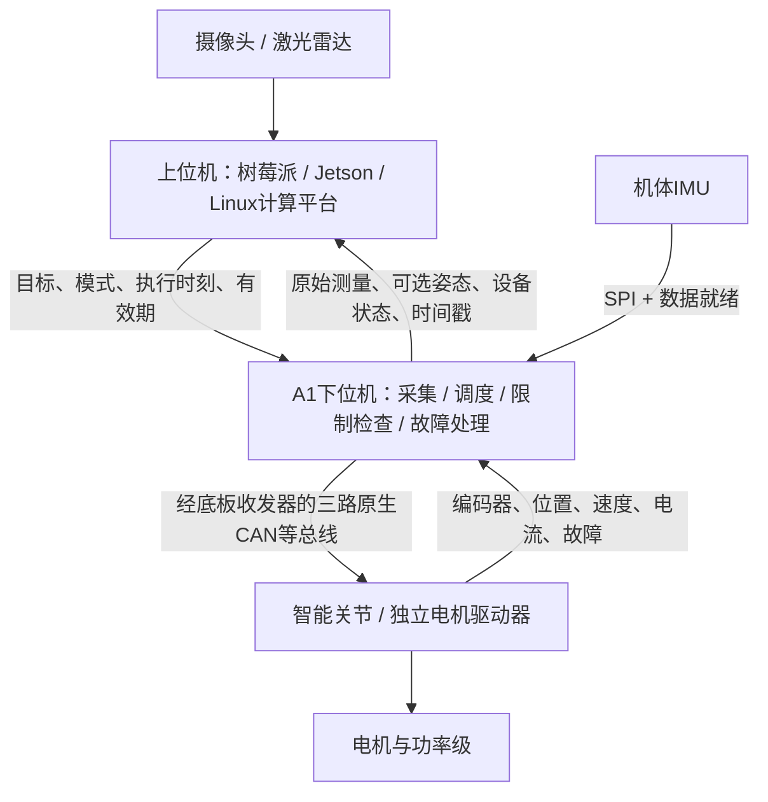

# 上下位机职责与IMU处理边界

> 2026-10-11 当前状态：已采用 [H735VGH6 + Direct SMPS](../总结分析报告.md)，三原生CAN为硬要求。本文保留早期共性研究和推导；旧MCU候选、v0.7资源/数值仅是研究背景，当前接法以[新引脚规划](../引脚规划.md)为准。

日期：2026-10-11；Docs v0.7.7。本文回应用户提供的SANPO通信板及ESP32-S3交互板资料。上位机指树莓派、Jetson或同类Linux算力平台；下位机指本项目。三路独立原生CAN仍是硬要求，当前已选H735VGH6；下文G474/H723比较保留为早期方案论证。

**建议：A1基础版负责通信、准确采样与时间戳、目标调度、故障处理；IMU轻量姿态估计作为可选本地服务，整机多传感器融合与复杂控制主要放上位机。先验证片内RAM方案，再决定是否增加外部RAM。**这是工程建议，不是已通过测试的性能规格。

## 1. 两张图片分别说明什么

| 对象 | 已核实事实 | 对本项目的启发与限制 |
| --- | --- | --- |
| SANPO旧版V4 | 用户截图写“双路STM32F4”；官方开发文档明确两颗STM32F407，各管理两路CAN和两路RS485 [S1] | 可以把通信和定时发送下沉，将复杂机器人算法留给树莓派。整板四路CAN不等于单颗MCU四路CAN |
| SANPO升级版V8 | 官方手册明确STM32G系列，两颗MCU各管理两路CAN/FDCAN及两路RS485，支持USB/SPI接入 [S2][S3] | 用户看到G系列的判断有依据；具体版本不能与F4截图混用。分担通信负载的双MCU架构，不证明单颗同系列芯片能满足A1全部并发要求 |
| Hiwonder ESP32-S3交互板 | 厂商重点介绍屏幕、摄像头、音频、Wi-Fi、离线视觉和小智AI；标称8 MB PSRAM [S4] | 面向交互与联网应用，资源需求与多路实时执行器总线不同；其PSRAM容量不能直接成为A1内存指标 |

小智上游固件默认连接服务器，支持网络音频交互 [S5]；“兼容大模型”不能理解为ESP32-S3在本地运行完整大语言模型。该板的具体固件版本和本地视觉性能本次没有实测。

两款板可以借鉴接口组织、SDK与通信抽象，但宣传图不构成实时性、抗扰度或安全认证证明。本轮核验产品定位和官方接口资料，未完成其完整电路审查。用户截图及来源记录见[本轮资料索引](../技术依据/architecture-boundary/README.md)。

## 2. 将系统分成三个计算层

| 功能 | 默认归属 | 原因 / 边界 |
| --- | --- | --- |
| 视觉、SLAM、导航、任务管理、复杂模型 | 上位机 | 需要较多内存、软件生态或多传感器信息 |
| 运动学、全身状态估计、MPC/WBC、较大RL策略 | 上位机应用 | 与具体机器人模型紧密相关；若构成快速闭环，必须验证整个链路截止时间 |
| 总线调度、设备协议、状态汇总、控制权、限值和超时 | A1 | 应在上位程序迟到、退出或重启时仍保持明确行为 |
| IMU采样、时间戳、标定、传感器健康检查 | A1（机体IMU接在A1时） | 靠近数据就绪信号，便于与设备状态统一计时 |
| 本地姿态和简单闭环 | A1可选服务 / 应用模块 | 用于确有需求的姿态反馈或本地保护；不把机器人专用算法写入通用底层 |
| FOC、电流环、换相、功率级保护 | 电机驱动器 | 贴近PWM、ADC、编码器；A1发送目标，不直接驱动三相功率级 |
| 速度/位置环 | 按驱动器及模式确定 | 智能关节可内部实现；中央外环也可由上位应用实现，不能重复放置同一闭环 |

任务边界取决于**截止时间、所需信息和故障后必须保留的行为**，不由CPU主频大小直接决定。PX4的飞控加伴随计算机架构说明：估计器可以在MCU，视觉在Linux；这是可参考的分工，不是所有机器人必须照搬的规则 [S6]。

普通Linux配置不能仅凭“平均计算很快”承诺固定截止时间；经过实时配置和应用约束也能承担实时任务 [S7]。若上位机承担平衡或力矩闭环，需要测量采样、上行、调度、计算、下行、CAN仲裁及驱动器应用目标的完整延迟，而非仅测算法耗时。

## 3. IMU“解算”要拆开讨论

### 3.1 采样、标定与时间：默认下位机

建议A1负责SPI读取、DRDY/FIFO处理、采样序号、采样时刻、量程/温度/饱和/丢样状态，以及可追溯的标定。上报芯片原始计数或经标定的角速度与加速度；两者应有不同的数据语义。

优先利用传感器自带时间或数据就绪捕获，并明确传感器数字滤波的群延迟。仅在中断入口读取时钟并不自动得到无误差的真实测量时刻；FIFO批量读取也不能给所有样本盖同一个时间戳。接收端需知道时间戳定义及不确定度。

硬件低通和必要抗混叠在采样侧配置；上位VIO/EKF输入不应被不透明的平滑、降采样或重力去除处理改变。任何处理均公布参数、延迟与版本，保留可用于重新融合的测量通道。

### 3.2 姿态估计：建议下位机可选提供

这里指陀螺仪和加速度计形成的四元数、横滚/俯仰等轻量AHRS服务。互补滤波、Mahony/Madgwick或规模受限的姿态滤波器可作为实现候选；具体算力、栈和精度必须实测，不能以算法名字承诺1 kHz运行。

本地姿态便于依赖姿态的模式持续获得短延迟反馈，上位程序也可直接读取它。若应用仅需把IMU送给上位VIO，或根本没有姿态相关功能，可以关闭AHRS；通用通信模式不应强制依赖IMU。

六轴IMU没有绝对航向观测，yaw会漂移；动态加速度也会影响用重力修正横滚/俯仰的效果 [S8]。磁力计在电机和大电流环境中还需校准和干扰评估，不能把“九轴”当作航向可靠性的保证。本地姿态必须附初始化状态、有效性和质量信息。

**有本地姿态不等于断联后能够维持任意机器人的稳定。**例如足式平台若依赖上位WBC输出力矩，本地仅有倾角估计并不能替代WBC；断联时的制动、降扭、保持或禁止行为必须按机械系统和驱动模式定义。

### 3.3 整机状态融合：默认上位机

IMU与轮速、关节编码器、足端接触、视觉、激光或GNSS共同估计机体位置、速度、姿态和偏置，通常放在上位机更便于获得全部观测及机器人模型。特别是VIO/SLAM往往需要带准确时间的陀螺仪与加速度样本，只有下位机四元数并不够。

上位融合器可以选择下位姿态作为观测，也可以自己从原始测量估计姿态。若同时使用由同一批IMU数据形成的姿态和原始测量，需处理相关性，不能默认是两份独立信息。零偏、坐标变换及重力补偿也要约定责任，避免上下两端重复修正。

### 3.4 不同应用的配置建议

| 配置 | A1 | 上位机 |
| --- | --- | --- |
| 轮式导航 | 电机总线、轮速/IMU采样，可选AHRS | 里程计融合、SLAM、导航 |
| 机械臂 / 台架 | 目标调度、状态与限值；IMU可关闭 | 运动学、轨迹、任务及应用控制 |
| 足式 / 动态平衡 | 同步采样、快速通信、故障反应，可选AHRS/经验证本地控制 | 接触/机体估计、WBC/MPC/策略；对端到端时序负责 |
| 视觉惯性应用 | 标定且时间明确的原始IMU流 | 相机同步、VIO及全局融合；优先核对相机与IMU时钟关系 |

若相机模组已集成同步IMU，上位VIO可使用该IMU，A1的机体IMU作为另一独立传感器声明外参；不应假定两者可以无标定互换。

## 4. 协议边界比“谁算四元数”更值得先确定

以下为协议设计输入，尚未冻结编码：

| 数据 / 服务 | 必须说清楚的语义 |
| --- | --- |
| IMU测量 | 传感器ID、序号、采样时刻、角速度rad/s、加速度m/s²、温度、饱和/溢出/丢样、原始或标定状态 |
| 本地姿态 | 四元数分量顺序与旋转方向、传感器/机体坐标、世界参考系、初始化/重置、航向来源、有效性 |
| 标定 | 标定版本、温度模型、安装外参、滤波/抽取参数；上位在线偏置与下位固定标定各自作用范围 |
| 时间服务 | MCU单调时钟、时钟单位、启动会话ID、与上位时钟的偏移/漂移映射及误差；USB到达时间不代替采样时间 |
| 执行器目标 | 模式、单位、序号、执行时间/期限、控制权、插值方式、最大队列长度、迟到/断联策略 |
| 诊断 | 最坏数据年龄、丢帧、队列高水位、时钟同步质量、总线错误和截止时间违例 |

ROS适配层保持一致的右手坐标系和明确的ENU/NED转换。REP-145目前标为Draft，可参考其IMU命名和单位约定；ROS消息定义支持“有加速度/角速度但无姿态”，缺失orientation时将`orientation_covariance[0]`设为`-1`，不能伪造一个有效单位四元数 [S8][S9]。

默认上报加速度计测得的比力，静止且z轴向上时约为+g；若另提供去重力加速度，应另行命名并注明所依赖姿态。协方差未知与测量不存在是不同状态 [S8][S9]。

周期命令需结合总线预算决定；上位机并非固定只能50～100 Hz。轨迹可在下位机按时插值，但队列增大也会增加数据年龄，不能靠无限缓冲或永久重复最后力矩来掩盖上位迟到。安全状态与硬件禁止路径必须独立于日志、网络及用户界面。

## 5. 对主控选型的影响

| MCU | 核心资源摘要 | 在当前要求下的判断 |
| --- | --- | --- |
| STM32G474xE | M4F最高170 MHz；512 KiB Flash；128 KiB RAM；3路原生FDCAN，共用3 KiB报文RAM [S10] | 正式纳入基础版候选；多总线网关、采集及轻量AHRS值得验证，不预先宣称性能达标 |
| STM32H723xG | M7最高550 MHz但有TCM ECC条件；1 MiB Flash；560 KiB非备份RAM另加4 KiB备份；3路FDCAN，共用10 KiB报文RAM [S11] | 适合需要更多片内余量、复杂本地算法或扩展接口的方案；可先不配外部RAM |
| STM32H743 | 2路原生FDCAN [S11] | 继续排除，较大内存不能补足第三路原生控制器 |
| ESP32-S3 | 1路TWAI，支持经典CAN，不支持CAN FD [S12] | 不符合三路原生CAN要求；有需要时才作为独立交互/联网模块考虑 |

G474的128 KiB由80 KiB SRAM1、16 KiB SRAM2及32 KiB CCM组成；CCM还存在可被DMA访问的SBUS别名，不能套用其他STM32系列“CCM一定不能DMA”的结论 [S10]。H723各区、ECC和DMA条件详见[S11]。两者报文RAM都不是普通软件堆，不能用外部PSRAM扩大硬件FIFO。

只把G474列入候选，不泛化为所有STM32G型号；也不把SANPO的双MCU结果当作G474单芯片实测。H7MS-Core-A1暂保留项目名称，不用名称中的H7预先排除其他方案。

比较时先完成“三路FDCAN＋上位USB/串口＋计划设备串口＋IMU＋I/O”的精确封装AF和DMA矩阵。旧UART7/UART8/TIM8等编号不能直接迁到G474。若有以太网、SDMMC或其他增强需求，再逐项核对芯片外设、引脚和板级配套；不能只比较170与550 MHz。

## 6. 是否还需要8 MiB外部RAM

**当前没有证据证明基础版需要。**此前docs/13回答的是“能否扩容”，外部RAM是技术候选，不是已量化的需求。收敛为通信、采集、安全和轻量姿态后，优先建立无外部RAM预算。即使保留H723，也可以仅用其片内RAM起步。

一个仅用于量级判断的IMU流算例：六轴各float32为24字节，再加8字节时间戳、4字节序号和4字节温度，共40字节/样本。1 kHz时为40,000字节/秒，100 ms历史占4,000字节；这里未计帧头、校验、对齐、姿态、协方差或重复缓冲，不能当作整板RAM预算。

因此IMU数据本身不是增加8 MiB RAM的充分理由。还需分别计入：RTOS任务栈、USB与各串口队列、CAN软件队列、协议解析、标定、滤波状态、Boot/升级及故障日志。长期记录优先由上位机保存，板端保留有界诊断；脱机长记录再单独评估NOR/TF，其容量不等于运行RAM。

若已证明存在长时突发缓存、较大本地算法工作区或其他明确缺口，再按[外部RAM研究](../对比与研究/三路原生CAN与H723外部RAM方案.md)选接口与器件。当前不因“以后可能用到”而把8 MiB RAM、144引脚封装、LCD或音频作为基础版前提。实际成本和功耗差异需要同条件报价与测量，本轮未得出降本百分比。

## 7. 下一步关闭选型的不确定性

1. 为代表配置冻结目标/反馈频率、每路CAN帧长与总线占用、计划串口数、IMU速率、主机链路和故障期限。三路CAN独立，不表示软件、时钟或报文RAM完全独立。
2. 完成G474xE与H723xG各自的引脚、Flash升级布局、RAM分区/队列上限和适用勘误审查；本次对G474是初步资源核验，尚未完成全部勘误及封装审查。
3. 在同一负载下验证三路CAN并发、IMU数据年龄、USB突发、AHRS耗时、内存峰值和上位暂停/重连行为。单路演示及平均CPU占用不能代替最坏情况测试。
4. 若G474满足全部接口、峰值内存与截止时间并有约定余量，可选它；若资源或功能余量不足，选择H723。只有片内方案存在已确认缺口时，才推进外部RAM。

## 8. 来源与证据范围

检索日期均为2026-10-11。以下为原厂、项目维护方或ROS官方仓库；在线内容可能更新，未声称全部原始PDF已离线归档。

- [S1 SANPO V4自定义固件与两颗F407](https://docs.sanporobot.com/v4/zh/custom_firmware_development.html)。
- [S2 SANPO V8快速开始：G系列、上下位连接及分工](https://docs.sanporobot.com/v8/zh/get_started.html)。
- [S3 SANPO V8接口和引脚说明](https://docs.sanporobot.com/v8/zh/board_schematic.html)。
- [S4 Hiwonder ESP32-S3产品资料](https://www.hiwonder.com/products/esp32-s3-development)：营销定位及标称资源，非独立性能报告。
- [S5 小智上游项目README](https://github.com/78/xiaozhi-esp32)：网络交互和默认服务器说明，不能据此推断该商品所有固件完全相同。
- [S6 PX4 v1.15系统架构](https://docs.px4.io/v1.15/en/concept/px4_systems_architecture)。
- [S7 ROS 2实时系统设计说明](https://design.ros2.org/articles/realtime_background.html)：实时性的概念、阻塞/缺页等风险及测量方法。
- [S8 ROS REP-145官方源码，Draft](https://raw.githubusercontent.com/ros-infrastructure/rep/master/rep-0145.rst)：坐标、测量及姿态约定；网页入口受访问校验限制，使用官方源码。
- [S9 ROS 2 sensor_msgs/Imu定义](https://raw.githubusercontent.com/ros2/common_interfaces/rolling/sensor_msgs/msg/Imu.msg)。
- [S10 ST STM32G474数据手册DS12288 Rev 6，2021-11](https://www.st.com/resource/en/datasheet/stm32g474ve.pdf)：首页、§3.5（RAM）、§3.33（FDCAN）；版本为本次官方链接返回版本。
- [S11 已完成的H723/H743手册及勘误复核](../对比与研究/H723与H743数据手册复核及选型判断.md)，其内附ST原始来源；[H723 DS13313](https://www.st.com/resource/en/datasheet/stm32h723vg.pdf)。
- [S12 Espressif ESP32-S3 TWAI官方指南，检索时stable指向v6.1](https://docs.espressif.com/projects/esp-idf/en/stable/esp32s3/api-reference/peripherals/twai.html)。
