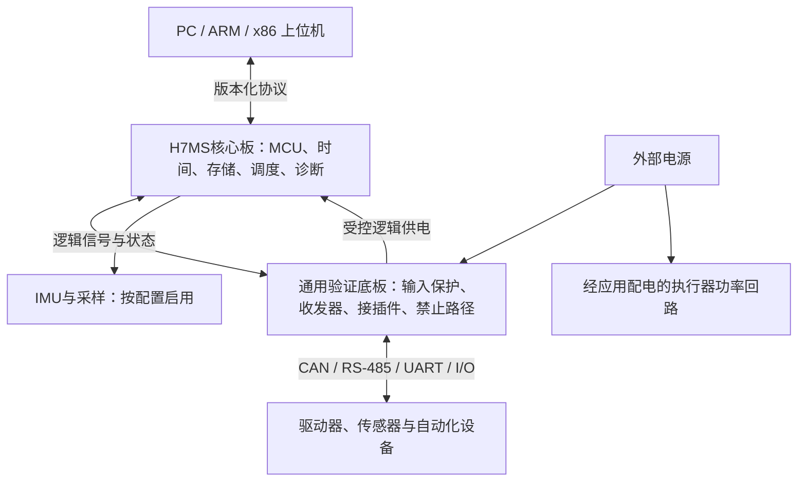

# 四款参考控制板：共性需求与H7MS选型结论

> 2026-10-11 当前状态：已采用 [H735VGH6 + Direct SMPS](../总结分析报告.md)，三原生CAN为硬要求。本文保留早期共性研究和推导；旧MCU候选、v0.7资源/数值仅是研究背景，当前接法以[新引脚规划](../引脚规划.md)为准。

调研日期：2026-09-15。对象：大疆RoboMaster A型、C型、达妙DM-MC02（H723），以及用户提供的D_MAIN_2558。本文用于通用机器人控制平台的需求与方案评审；结论来自文档和电路图，未进行实物测试。

**建议把达妙的总线配置作为通信参考，把D_MAIN_2558的电源保护与诊断思路作为硬件参考，借鉴A板的接口标识和配电、C板的紧凑组织与IMU分区。不要把四块板的功能并集当作首版必选清单。** 后续已明确三路原生CAN为硬要求，并选择H735VGH6；以太网不在当前同时保留的接口范围。

## 1. 资料、版本与结论边界

| 对象 | 已取得的证据 | 独立评估 | 需要保留的限制 |
| --- | --- | --- | --- |
| DJI A型 | 官方用户手册；第三方仓库保存的原厂格式原理图，10页 | [A型评估](<../../DJI A/总结分析报告.md>) | 原理图不是本次从DJI服务器取得；图纸页签为2～11/11，不声称获得完整EDA工程 |
| DJI C型 | 官方手册、官方CDN原理图与位号图ZIP；含主板及IMU FPC小板 | [C型评估](<../../DJI C/总结分析报告.md>) | 审查的是归档的V1.0图纸，不能代表所有市售修订 |
| 达妙DM-MC02 | 厂商项目链接的Gitee仓库：V1.0-240124原理图、2025-07-23 V1.1手册 | [达妙评估](<../../达妙 DM-MC02/总结分析报告.md>) | 手册比图纸新；容量单位、输入电压描述有待澄清处 |
| D_MAIN_2558 | 用户提供的7份DXF，逐份保留原始字节，并生成预览和文本索引 | [D_MAIN评估](../../D_MAIN_2558/总结分析报告.md) | 缺原生EDA、PCB、BOM、装配选件及固件；DXF部分文字重叠，不能代替网表/ERC |

原始文件、版本、链接和SHA-256见[资料总索引](../../README.md)。分别打包的资料与评估见[本次归档](../../../archives/2026-09-15_board-research/README.md)。图中未见某项能力，仅表示本次证据未覆盖；不据此断言所有修订或芯片本身都不支持。

## 2. 把芯片、控制器、收发器和接口分开比较

下表主频和片内存储采用芯片规格；板载外围采用归档图纸/手册。主频均为型号上限，未经固件配置和实测确认。RAM为分区总量，不能视为一块所有DMA都能访问的连续空间。

| 资源 | DJI A型 | DJI C型 | 达妙DM-MC02 | D_MAIN_2558 |
| --- | --- | --- | --- | --- |
| MCU | STM32F427IIH6，M4/BGA | STM32F407IGH6，M4/BGA | STM32H723VGT6，M7/LQFP100 | STM32H723VGH6，M7/TFBGA100 |
| 主频上限 | 180 MHz | 168 MHz | 550 MHz | 550 MHz |
| 片内Flash / RAM | 2 MB / 256 KB，另4 KB备份RAM | 1 MB / 192 KB，另4 KB备份RAM | 1 MB / 564 KB，含备份RAM | 1 MB / 564 KB，含备份RAM |
| 独立CAN控制器 | 2路经典CAN | 2路经典CAN | 3路片内FDCAN | 3路片内FDCAN＋1路MCP2518FD |
| CAN接插件与拓扑 | 10口：CAN1六口、CAN2四口 | 4口：两条总线各两口 | 3路总线接口 | CAN1～3有独立接口；CAN4经扩展连接器；姿态模块挂在CAN3 |
| RS-485物理层 | 图中未见 | 图中未见 | 2路 | 1路，UART7＋SN65HVD75 |
| 上位/调试链路 | Micro-USB、UART、SWD | Micro-USB、UART、SWD | USB-C、UART、SWD | USB-C＋CH334 HUB，H723/调试MCU/姿态模块USB串口分支，另有SWD相关电路 |
| 姿态资源 | MPU6500＋IST8310、加热 | BMI088 FPC小板＋IST8310、加热 | BMI088、加热 | BMI088、加热；另有FDI-Delta10模块 |
| 外部非易失存储 | TF | 本次图纸未见TF/QSPI | W25Q64JV：8 MB | W25Q128JV：16 MB，另TF及小容量EEPROM |
| PWM/扩展 | 16路可选电压PWM＋4路无供电PWM；多UART | 7路PWM；SPI/I²C/DCMI等 | 4路PWM；串口、DCMI、LCD和板间扩展 | 40Pin扩展及多类接口；不把所有引脚复用功能算作同时可用 |
| 以太网板级链路 | 本次图纸未见PHY | 本次图纸未见PHY | 本次6页图纸未见PHY | LAN8720A RMII PHY；磁性器件/RJ45等需配套板补全 |
| 主要风格 | 配电与大量接插口 | 紧凑实时控制 | 多总线电机/设备通信 | 高集成接口、保护、诊断与开发便利性 |

芯片依据：[ST F427II](https://www.st.com/en/microcontrollers-microprocessors/stm32f427ii.html)、[ST F407IG](https://www.st.com/en/microcontrollers-microprocessors/stm32f407ig.html)、[ST H723数据手册](https://www.st.com/resource/en/datasheet/stm32h723vg.pdf)。外部CAN控制器依据：[Microchip MCP2518FD](https://www.microchip.com/en-us/product/mcp2518fd)。每块板的具体页码及电路依据在独立评估中。

需要避免的四种资源误读：

1. 多个CAN插座可以并接同一总线，不能增加带宽或故障隔离能力。A板的10口不是10路CAN控制器。
2. CAN FD收发器不能把F407/F427的经典CAN控制器升级成FD。FD需要控制器、物理层、布线和网络节点共同支持。
3. PWM通道会共用定时器周期。例如C板7路主要来自TIM1和TIM8；不能承诺7个任意独立频率。
4. NOR Flash容量以bit和Byte严格区分：64 Mbit＝8 MB，128 Mbit＝16 MB。外部NOR不是扩展工作RAM。

## 3. 从共性提炼需求，而不是照搬配置

| 需求 | 在参考板中的依据 | H7MS建议与验收方向 |
| --- | --- | --- |
| 可恢复的最小系统 | 四者都有时钟、复位/启动、调试或下载入口 | 核心板必需；错误固件、反复掉电后仍能通过明确流程恢复 |
| 可靠供电和负载分区 | 都围绕外部电源产生逻辑电源，电机/外设用电与MCU用电有所区分 | 底板定义输入范围、反接/浪涌/过流、反灌、温升与上电默认状态；按支路核算电流 |
| 至少一条稳定的上位链路 | USB与UART普遍存在 | USB Device＋独立UART作为候选；定义控制权、版本、心跳、命令有效期和重连行为 |
| 多节点设备通信 | 四者均采用CAN；达妙及D_MAIN增加RS-485 | 先用2路独立CAN FD验证不同设备网络，是否增加第3路由拓扑和负载决定；串口物理层按底板配置 |
| 传感采集和时间基准 | IMU在四者中普遍存在 | 移动机器人可保留IMU；时间戳、中断延迟和采样一致性必需；恒温、磁力计或第二姿态模块按场景选配 |
| 可解释的I/O | PWM、UART、SPI/I²C、模拟量及扩展接头 | 每个产品配置发布“引脚—外设—DMA—定时器—电压—并发”矩阵，不以芯片最大资源宣传板卡能力 |
| 调试与状态可见 | SWD、串口、LED/蜂鸣器和电压采样普遍存在 | 保留外部SWD/NRST、状态日志、复位原因、欠压/总线错误统计；板载调试器和HUB可后置 |
| 可维护资料 | 官方说明、原理图、接口表提供接入依据 | 原理图、PCB、BOM/装配、.ioc、固件、SDK、接线与验收记录需要同版本可追溯 |

以下是通用平台还需要补足的要求，不能由“市售板采用了某电路”推定已经满足：

- **故障禁止路径。**四套图纸不足以证明系统具有独立于主程序的急停/停止能力。需要按设备定义断联、MCU挂死、复位、掉电时的禁止输出及重新使能路径；GPIO开关电源、看门狗和设备STO不是同一个功能。
- **实际线路适应性。**CAN终端可配置、RS-485偏置不重复叠加、共模范围与地回路可接受；是否需要隔离由电源和线路环境决定。共模电感/磁珠不构成电气隔离。
- **满负载时序。**需要以P0～P4配置测量端到端延迟、抖动、丢帧、队列峰值和故障响应；主频、接口位率和空载示例都不能代替这些结果。
- **功率边界。**电池标称电压不等于最高充电电压；连接器额定值、整板允许输入、电源芯片极限和每路输出额定值分别记录。

## 4. 核心板和底板如何分配

优先保留现有核心/底板结构：核心板关注最小系统、实时资源、必要存储和调试；底板负责电池输入、物理层、终端、外设供电及接插件。D_MAIN是集成程度更高的参考，不能直接映射到H7MS既有双50Pin接口。

推荐首版先完成2路CAN FD、USB/UART上位链路、一种串口设备物理层、IMU/基础I/O和故障处理。现有4组TX/RX/DIR规划保留待审；达妙2路RS-485说明其有参考价值，不代表必须把4路串口都做成RS-485。TF、恒温、板载HUB、第二姿态模块、SPI扩展CAN和网络功能逐项论证收益。

**以太网必须在布局前决策。**如果需要PC网络、多控制板分布或网络日志，应同时预算MAC/RMII引脚、PHY与参考时钟、磁性器件、ESD、连接器、DMA缓冲、协议栈和实时任务隔离。当前Pin Plan v0.7没有因此自动获得可用以太网接口；不能只在底板加RJ45就承诺支持。

## 5. H743与H723：本次调研改变了哪些判断

| 决策条件 | 倾向 | 理由及代价 |
| --- | --- | --- |
| 2条独立CAN足够，协议栈/日志/算法需要更多片内空间 | 继续评估H743VI | 2 MB Flash、约1 MB RAM，保留更多静态容量；仍须逐区核算DMA可达性 |
| 需要3条独立CAN且希望均为片内控制器 | 优先重新评估H723VG | 3路FDCAN是明确的外设收益；片内Flash/RAM减少，AF、时钟、内存与封装都须重做复核 |
| 需要第4条独立CAN | 原生总线架构或SPI扩展方案专项比较 | D_MAIN提供MCP2518FD范例，但增加SPI占用、IRQ、驱动、队列和故障恢复工作 |
| 主要问题是计算超时 | 先测量，再比较芯片 | 550/480仅约1.146的频率比例，不能预测系统实际加速；缓存、数据放置和总线竞争同样影响结果 |
| 主要问题是可制造性与调试 | 独立比较BGA和LQFP | 达妙为LQFP100，D_MAIN为TFBGA100；同系列/100引脚不等于相同封装或可直接替换 |

H743的2路FDCAN依据[ST H743VI](https://www.st.com/en/microcontrollers-microprocessors/stm32h743vi.html)，H723的3路及存储依据[DS13313](https://www.st.com/resource/en/datasheet/stm32h723vg.pdf)。这段比较记录早期选择条件；当前三CAN要求已排除H743，H735资源分配见当前方案。

## 6. 采纳与后续关闭项

| 编号 | 本次建议 | 需要的关闭证据 |
| --- | --- | --- |
| R01 | 先冻结总线拓扑，再冻结MCU | 2路还是3路片内CAN、节点/负载/故障分组，连同现有UART需求形成矩阵 |
| R02 | 首版网络功能明确保留或后置 | 上位链路吞吐/距离/连接方式需求；若保留则完整引脚、电源、RAM和PHY方案 |
| R03 | 参考D_MAIN完善分支保护 | 电源树、每级电流与热预算、USB/外部电源优先级；0Ω装配选件和禁止旁路规则 |
| R04 | CAN终端与串口物理层配置化 | 终端开关/DNP、偏置、保护及地参考的装配表和接线图 |
| R05 | 实时采样优先获得可预测总线 | 避免IMU与高负载扩展CAN争用；若共用则提供最坏阻塞分析与并发测试 |
| R06 | 保持可独立下载和调试 | SWD/NRST、BOOT、故障恢复流程；HUB/板载调试器不成为唯一恢复入口 |
| R07 | 给安全和维护留下硬件资源 | 明确看门狗、使能默认态、故障反馈及应用停止接口；不以指示灯替代诊断 |

这些结论已接入[主控选型记录](../../../archives/2026-10-11_before-docs-v0.8.0/README.md)、[需求基线](../需求基线.md)和[H0待办](../项目管理/项目状态与待办.md)。原研究阶段仅完成资料分析；2026-10-11已升级至Pin Plan/Stack Interface v0.8草案，正式EDA与硬件测试仍未完成。
