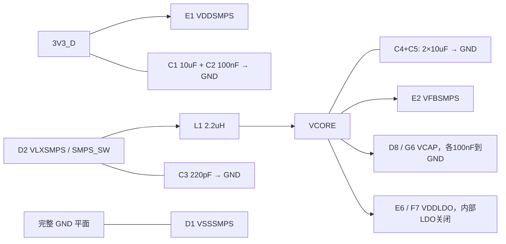

# 最小系统连接草图（非 EDA 图纸）

> v0.8 历史电源参考。当前外设、引脚和核心/扩展边界见[v0.9 工程规划](../工程规划/README.md)，绘图不得混用新旧接口。

2026-10-11。数值及元件位号与[完整接法](../最小系统与外围规划.md)共同使用。



```text
3V3_D ──10k── NRST(F2) ── SWD nRESET
                  ├──100nF──GND
                  └──复位按钮──GND

3V3_D ── BOOT 跳帽 ── BOOT0(A5) ──10k──GND
SWD: VTref=3V3_D / PA13(C10) / PA14(C9) / NRST / GND
PDR_ON(D3)=3V3_D
```

图中没有将 SMPS 输入、开关和内核输出合并：三者分别是 3V3_D、SMPS_SW、VCORE。器件内部连接由原厂定义，图仅表达外部接线；完整电源/地、晶振及其余 IO 不可因未画进草图而省略。
