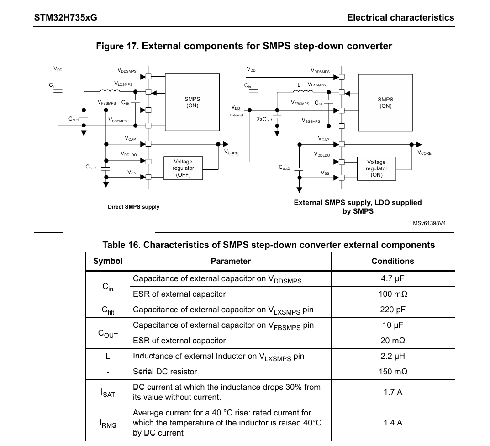

# H735VGH6与H723VGH6：引脚、供电、面积和采购比较

> 历史选型研究，保留推导及来源。2026-10-11 已选定 STM32H735VGH6 + Direct SMPS；当前权威入口为[总结分析报告](../总结分析报告.md)及[引脚规划](../引脚规划.md)。本文旧候选建议不覆盖当前方案。

日期：2026-10-11；Docs v0.7.13。本文给出选型建议和可复核引脚候选，不是已冻结的原理图、BOM或生产文件。

## 1. 本轮结论与需求范围

**建议优先采用 STM32H735VGH6，核心供电按 Direct SMPS 方向设计；STM32H723VGH6保留为供电简单、引脚余量较多的备选。**用户已说明H735VGH6可从其他渠道获得合适货源，本轮接受这个采购前提；公开商城缺货不再作为否决理由。具体成交价、数量与交期没有获得，不虚构用户渠道报价。

推荐理由是当前接口能够装入8×8 mm、0.8 mm球距封装，而SMPS有助于降低持续计算时的供电损耗。**H735没有比H723更多的RAM、更高的最高主频或更小的芯片本体，且本封装可用引脚更少。**它的额外能力主要是SMPS、加密/HASH和外存即时解密。若完全不用SMPS，也不需要加密能力，H723的外围与资源取舍更合理。

最新用户要求是“跟进DM控制板的引出资源，或者根据之前H723板子的引出资源”。据此采用达妙DM-MC02的功能类别作为扩展参考，保留此前H723候选的必需接口；不再要求照搬旧H743 v0.7的完整TIM1互补PWM/刹车、TIM2四通道和四片选SPI3。功能相当不表示达妙接插件、GPIO或固件可以直接兼容。

本轮同时保留：三路独立原生CAN、USB FS Device、SPI IMU、四组设备串口TX/RX及DIR、Quad W25Q128。扩展候选还含四路PWM、SPI/I²C、辅助串口、ADC、TF、状态指示和底板握手。**DCMI摄像头、RMII以太网、USB Hub/板载调试器、第四路外置CAN不计入这组并发承诺。**这些是参考板的额外功能，若以后纳入需求，须重新分配资源。

## 2. 精确封装与芯片资源

| 项目 | STM32H723VGH6 | STM32H735VGH6 | 对A1的影响 |
| --- | --- | --- | --- |
| CPU | Cortex-M7，最高550 MHz，双精度FPU | 相同 | 型号升级不带来CPU档次变化；频率、电压与硅版本条件需落实 |
| 内置Flash | 1 MiB | 1 MiB | 相同升级/固件预算 |
| RAM | 560 KiB非备份RAM＋4 KiB备份SRAM | 相同 | 不能把564 KiB看成单一连续DMA缓冲区 |
| 三路CAN控制器 | 2×FDCAN＋1×TT-FDCAN | 相同 | 三路独立控制器，共享报文RAM需分别划区 |
| 精确封装 | TFBGA100，8×8 mm，0.8 mm球距 | 相同 | 芯片本体均64 mm² |
| 数据手册封装表GPIO数 | 80 | 74 | 不能用系列最大GPIO数代替VGH6资源 |
| 相较H723缺少的端口名 | — | PE11、PE12、PE13、PE14、PE15 | 丢失部分TIM1/SPI4等复用选择 |
| 内核稳压 | LDO | LDO或内置SMPS等供电方式 | H735使用SMPS需外接电感/电容 |
| 加密/HASH、OTFDEC | 无H735对应加速能力 | 有 | 作为升级/安全与外存研究余量，不等同现成安全产品 |
| VGH封装OctoSPI引出 | 1组 | 1组 | Quad NOR可用；不能按系列首页“2组”规划双完整独立总线 |
| VGH完整16位SDRAM接口 | 不具备 | 不具备 | 数MiB外部RAM仍需单独研究封装与串行存储组合 |

依据：[ST H723数据手册DS13313 Rev5，表1及封装章节](https://www.st.com/resource/en/datasheet/stm32h723vg.pdf)、[ST H735数据手册DS13312 Rev4，表2及封装章节](https://www.st.com/resource/en/datasheet/stm32h735ig.pdf)。H735链接文件名含IG，但正文覆盖整个xG系列，已按TFBGA100列核对。560 KiB中包含不同总线域与TCM；192 KiB共享区的ITCM/AXI分配影响程序和数据布局。

**两颗芯片不能在同一PCB上直接换料。**封装机械尺寸相同，电源和大量信号的球位不同。已有62信号候选中54个球位发生变化；例如NRST从H723的E1变为H735的F2，H723的PE12/J6位置在H735对应PE8。完整100球对照见[all-100-balls.csv](../技术依据/vgh-comparison/all-100-balls.csv)。不能只改BOM型号或EDA符号标题。

ST封装XML中带端口名的焊盘分别为82/77，其中包括振荡器、专用模拟端口等；这与数据手册80/74的GPIO统计口径不同。后文75指独立信号焊盘，不表示75个普通GPIO，也不能直接用“74−75”判断资源溢出。

## 3. 根据达妙资源收敛引出方案

### 3.1 参考什么、如何迁移

复查资料为已归档的[DM-MC02原理图V1.0](<../../达妙 DM-MC02/原理图/schematic-v1.0-240124.pdf>)和[用户手册V1.1](<../../达妙 DM-MC02/资料/user-manual-v1.1.pdf>)，并与此前[独立评估](<../../达妙 DM-MC02/总结分析报告.md>)对照。原理图第1页和手册接口页均已查看；手册不是本板电气连接的设计授权。

| 达妙/既有H723参考资源 | A1建议处理 | 说明 |
| --- | --- | --- |
| 三CAN、两RS-485、额外TTL串口 | 保留三原生CAN、四组TX/RX/DIR | 物理层放接口底板；每组可按用途装TTL/RS-485等，不能直接把MCU脚接总线 |
| 四路PWM | 保留4个普通输出通道 | TIM2三通道＋TIM1一通道；不要求整套互补PWM/刹车 |
| BMI088、加热、USB、NOR | 保留对应能力 | SPI1独立给IMU；预留双CS和双中断；NOR由DM的8 MiB扩为项目W25Q128的16 MiB |
| LCD用SPI/I²C、扩展IO | 保留独立扩展SPI3与I²C2 | LCD的DC/RESET/背光/按键仍需按模块组合分配，不能承诺达妙屏线序直插 |
| 辅助串口/SBUS | 在4组设备串口外，保留UART8上位备用和UART7辅助 | SBUS作为UART7 RX用途之一，须验证反相、电平及100 kbit/s帧格式，不额外算第七路串口 |
| 指示灯、蜂鸣器、用户交互 | RGB、蜂鸣器、SWD/复位保留 | PB1、PE10可供后续按键/显示控制等选择；每个脚只能承担一种同时使用的功能 |
| TF和电源采样（此前H723方案） | 继续列入扩展候选 | DM板不具备全部这些功能；本候选是两类参考的功能组合 |
| DM的DCMI摄像头 | 替代配置，不纳入同时使用基线 | 原线序使用PC6～PC9、PA4/PA6等，会与本候选的TF、IMU及其他信号冲突；相机优先接树莓派类上位机 |
| D_MAIN的RMII、Hub、板载J-Link与第四CAN | 不自动继承 | 用作系统设计参考，用户未要求将完整调试开发板压入核心板 |

DM参考板自身也存在同一MCU脚引向不同功能连接器的情形；“接口在板上”不等于全部可并发。采用功能类别后重新映射，是保留通用性的必要步骤。

### 3.2 必需接口的无冲突映射

以下GPIO在H723VGH6和H735VGH6均可使用，**球位不同**；完整逐信号、球位、AF见[两型号DM功能候选CSV](候选引脚/STM32H735_H723_VGH_DM_interfaces.csv)。

| 功能 | 引脚/外设分配 | 注意事项 |
| --- | --- | --- |
| CAN1 RX/TX | PB8/PB9，AF9 | 原生FDCAN1 |
| CAN2 RX/TX | PB12/PB13，AF9 | 原生FDCAN2 |
| CAN3 RX/TX | PD12/PD13，AF5 | 原生FDCAN3，不能再把这组脚给其他旧功能 |
| USB D−/D+ | PA11/PA12 | USB_OTG_HS控制器的片内FS PHY，12 Mbit/s总线速率，并非480 Mbit/s |
| IMU SPI1 | PA5 SCK、PA6 MISO、PA7 MOSI，AF5；PA4/PA15双CS；PC4/PC5中断 | 可覆盖BMI088双片选组织；具体IMU未冻结 |
| 设备串口1 | USART1：PB14 TX、PB15 RX，AF4 | DIR使用PA8 |
| 设备串口2 | USART2：PD5 TX、PD6 RX，AF7 | DIR使用PA10 |
| 设备串口3 | USART3：PD8 TX、PD9 RX，AF7 | DIR使用PD14 |
| 设备串口4 | UART4：PD1 TX、PD0 RX，AF8 | DIR使用PD15 |
| Quad W25Q128 | PB2 CLK AF9、PB6 NCS AF10、PD11 IO0 AF9、PB0 IO1 **AF4**、PE2 IO2 AF9、PA1 IO3 AF9 | OCTOSPIM_P1；16 MiB NOR不是工作RAM |

三CAN STB为PD3/PD4/PD7。PA9用于经过适当电平处理的VBUS存在检测/EXTI9，再由软件管理USB接入；不是把PA9当作这颗控制器的专用VBUS sensing脚。四组DIR是软件GPIO方案，默认电平和收发切换必须与底板收发器匹配。

### 3.3 新增达妙风格扩展

保持既有62信号候选完整不变，新增下表13个信号，共75个不同焊盘：

| 扩展 | 分配 | 同时使用边界 |
| --- | --- | --- |
| PWM1/2/3 | PA0 TIM2_CH1、PA2 TIM2_CH3、PA3 TIM2_CH4，均AF1 | 三路共享TIM2周期，占空比可分别设置；不是三套独立频率 |
| PWM4 | PE9 TIM1_CH1，AF1 | 与前三路属于另一计时器；不是完整互补PWM接口 |
| 扩展SPI3 | PB3 SCK AF6、PB4 MISO AF6、PB5 MOSI **AF7**；PE4 GPIO CS | 与IMU SPI1独立；保留SWD，放弃这些脚的JTAG/SWO用途 |
| 底板电压/电流 | PC0 ADC3_INP10、PC1 ADC3_INP11 | 底板必须进行分压/调理与限幅 |
| 核心5V监测 | PC2_C ADC3_INP0 | 专用模拟通道；5V经分压后采样，不能直接接5V |
| 辅助串口 | PE8 UART7_TX、PE7 UART7_RX，AF7 | 可用于传感器或RX侧SBUS；与辅助串口用途互斥 |

既有扩展含UART8（PE1/PE0）、I²C2（PB10/PB11）、4-bit SDMMC1（PC8～PC12/PD2）、卡检测、IMU加热与NTC、RGB、蜂鸣器、LSE、HSE保留脚、电源使能/反馈和急停/故障信号。因此，总体是**四路设备串口＋一路上位备用UART＋一路辅助UART**，不能把6路都描述成带独立RS-485物理层。

H735未分配端口名只剩PB1、PE10；H723另有PE11～PE15，共7个。PH1在8 MHz有源HSE bypass配置下也有条件重新评估，但当前仍预留，不把它重复计作可用余量。H735当前已经较满，若今后明确要求更多独立CS、编码器、完整高级定时器、RMII或摄像头并发，应重新评估H735IGK6，而非继续挤占已有接口。

旧H743整套独立扩展恢复时约需86个信号焊盘，而且H735VGH6的TIM1_CH4只能落PA11，与USB D−冲突；这项核算见[pin-audit.json](../技术依据/vgh-comparison/pin-audit.json)，**仅保留作历史边界，不是本轮用户要求**。

已用ST公开封装XML和GPIO AF数据库核查两型号各75条：封装引出、球位、普通AF、焊盘唯一性、EXTI线不冲突均通过。USB专用PHY仅核对引出，未用普通GPIO AF规则冒充验证。尚未有CubeMX .ioc、时钟/DMA分配、Cache一致性、模拟通道建立时间、PCB走线或混合负载实测。候选CSV也不是含电源、BOOT0、NRST在内的完整连接器/原理图清单。

### 3.4 少掉的PE11～PE15是否重要

**对当前以智能电机总线、传感采集和调度为主的下位机，这组损失可接受；对以后直接做电机功率控制或增加高速独立接口，则有明显价值。**不能只用“少5个GPIO”判断，更不能把H735描述为引脚资源全面升级。

| H735VGH6未引出的端口 | H723VGH6上的部分重要功能 | 对当前候选的影响 |
| --- | --- | --- |
| PE11 | TIM1_CH2、SPI4_NSS、OCTOSPIM_P1_NCS | 目前NOR NCS已分配PB6；TIM1_CH2的PA9替代位置已用于VBUS检测 |
| PE12 | TIM1_CH3N、SPI4_SCK | 影响互补PWM及SPI4备用分配；当前扩展使用SPI3 |
| PE13 | TIM1_CH3、SPI4_MISO | TIM1_CH3可改PA10，但当前该脚已作设备串口DIR |
| PE14 | TIM1_CH4、SPI4_MOSI | H735VGH6的TIM1_CH4只剩PA11，与必需USB D−冲突 |
| PE15 | TIM1_BKIN | BKIN还有PA6/PB12，但本候选分别用于IMU MISO/CAN2 RX；不能在不重分配的情况下直接补上 |

这五脚还带有FMC_D8～D12、部分显示/音频/比较器等复用选择。表中只是与本项目相关的重点，不是完整AF表。这里讨论通道的外部引出，TIM1_CH4不能同时从PA11输出不等于内部比较/触发不可用，也不能据此断言H735无法实现FOC；三相互补PWM需要单独重分配并验证。原始功能及替代脚当前占用见[lost-pin-impact.json](../技术依据/vgh-comparison/lost-pin-impact.json)，依据ST精确封装XML复核。

SPI4外设没有从芯片中消失：H735VGH6仍可使用PE2 SCK、PE5 MISO、PE6 MOSI和PE4 NSS。但这四脚在本候选分别承担NOR IO2、TF卡检测、底板故障和SPI3片选，因此是“可以重新设计”，不是“现在仍有一组空闲SPI4”。同理，TIM1仍在，保留四路普通PWM也不意味着完整TIM1互补输出/硬件刹车均可并发。

当前75信号方案已把三CAN、USB、IMU、四设备UART、NOR与DM风格扩展排下，所以没有损失这些必需功能；主要代价是引脚替代路径和未来余量。若外接CAN/RS-485智能驱动器，本板不生成其电机三相互补PWM，TIM1整组的重要性较低；若要直接控制MOSFET桥、使用硬件刹车或增加多组独立定时器，应重新选择封装/架构。

慢速按键、指示和非关键使能可考虑I²C/SPI GPIO扩展，以释放MCU脚；这不能等价补回硬件PWM、定时器捕获或可靠的异步刹车输入。是否需要扩展芯片应按真实缺口决定，本轮不加入BOM。即使关闭H735的SMPS，这五个未封装引出的GPIO也不会恢复。

## 4. 供电外围：H735的收益和成本

### 4.0 在官方PDF中找到设计位置

H735数据手册本身有SMPS连接图，不能只查看前面的功能简介。以下页码对应**DS13312 Rev4（286页）**与**AN5419 Rev3（52页）**，均为PDF正文印刷页码；其他版本请按章节/图号搜索。

| 文件与页码 | 搜索标题/编号 | 用途 |
| --- | --- | --- |
| [H735数据手册第120页](https://www.st.com/resource/en/datasheet/stm32h735ig.pdf#page=120) | §6.3.3 `SMPS step-down converter` | 明确说明完整外围要求见AN5419，图17/表16是数据手册特性测试所用外围 |
| [H735数据手册第121页](https://www.st.com/resource/en/datasheet/stm32h735ig.pdf#page=121) | 图17 `External components for SMPS step-down converter`；表16 | **图17左侧为本项目推荐的Direct SMPS supply**；右侧为SMPS供LDO的另一种接法，不能混用 |
| [AN5419第6页](https://www.st.com/resource/en/application_note/an5419-getting-started-with-stm32h723733-stm32h725735-and-stm32h730-value-line-hardware-development-stmicroelectronics.pdf#page=6) | 图2 `System supply configuration`，第2种配置 | 对照Direct SMPS、LDO和级联等电源模式 |
| [AN5419第7～9页](https://www.st.com/resource/en/application_note/an5419-getting-started-with-stm32h723733-stm32h725735-and-stm32h730-value-line-hardware-development-stmicroelectronics.pdf#page=7) | 表2 `Power supply connection`；第9页图3 `Power supply component layout` | 外围元件、去耦及放置要求；按所选电源模式使用 |
| [AN5419第17页](https://www.st.com/resource/en/application_note/an5419-getting-started-with-stm32h723733-stm32h725735-and-stm32h730-value-line-hardware-development-stmicroelectronics.pdf#page=17) | §2.1.7 `SMPS step-down converter` | 上电、直接供内核及运行/低功耗模式说明 |

这里的SMPS是MCU内部已有开关稳压器，外部补齐电感、电容和反馈连接，不是另加一颗完整降压芯片。VCORE是内核供电，不能把推荐接法理解为外接3.3V到VCAP。具体电气约束仍按手册及下述设计输入落实。

### 4.1 H723的LDO与H735的两种可行方式

H723采用内部LDO时，VCAP外接两颗2.2 µF低ESR电容，并配置VDD/VDDA/USB等电源去耦。H735VGH6同时引出VDDSMPS、VLXSMPS、VFBSMPS、VSSSMPS、VDDLDO和VCAP，可以选择LDO-only，也可以选择Direct SMPS。**H735并非必须使用电感**；只在启用SMPS时才需要其外围。

H735若采用LDO-only，SMPS关闭，VDDLDO接对应供电、VCAP使用LDO电容配置，未使用SMPS端子的接法按AN5419图4处理。这能降低初版电源复杂度，但不会恢复PE11～PE15，且失去本轮优先选H735的主要功耗收益。

建议的Direct SMPS路径为：3.3V供VDDSMPS，内部开关节点VLXSMPS通过外部电感接输出，VFBSMPS反馈输出；输出给内核供电节点，按直接SMPS配置连接VCAP/VDDLDO，内部LDO旁路。核心板仍需5V→3.3V电源，底板仍需主输入降压；芯片SMPS不能替代这两级。

### 4.2 Direct SMPS的初步元件与布线输入

按[ST AN5419 Rev3（2026-01），表2、图2～4及§2.1.7](https://www.st.com/resource/en/application_note/an5419-getting-started-with-stm32h723733-stm32h725735-and-stm32h730-value-line-hardware-development-stmicroelectronics.pdf)：

| 项目 | 本轮设计输入 | 需要落实 |
| --- | --- | --- |
| 电感 | 2.2 µH；指南参考DCR 110 mΩ、Isat 1.7 A、Itemp 1.4 A | 精确型号、尺寸、温升和饱和能力 |
| 输入电容 | 指南提供10 µF、2×10 µF、10 µF＋100 nF、10 µF＋4.7 µF四种组合 | 先按10 µF＋100 nF布局研究，不同时装下所有替代组合 |
| 输出电容 | 2×10 µF，指南给出ESR 5 mΩ条件 | DC bias后的有效容量及回路布局 |
| 开关节点小电容 | BGA/LQFP配置220 pF | 紧贴VLXSMPS，控制开关环路 |
| VCAP旁路模式去耦 | 每个VCAP按100 nF配置 | 替换LDO模式的2.2 µF方案；不要无依据叠加两套 |
| 其他供电 | 各VDD就近100 nF及公共4.7 µF；模拟、参考、USB等各自去耦 | H735VGH另有独立VREF+，须纳入模拟供电设计 |

DS13312 Rev4的SMPS特性表给出的测试外围与较新AN5419 Rev3部分数值不同，例如输入电容和电感DCR。前者是特性测试条件，后者为硬件设计指南；本表以较新指南作为设计输入，**尚不是已定BOM或已验证稳定性结论**。最终元件需同时符合电气规格，不能只匹配“2.2 µH/10 µF”字样。

电源相关球位便于核查：

| 网络 | H723VGH6 | H735VGH6 |
| --- | --- | --- |
| VDD | D2、F4、F5、K1 | D6、E5、F6 |
| VSS | C2、E4、E5、E6、J1 | C1、D5、E7、F5 |
| VCAP | E7、F8 | D8、G6 |
| VDDLDO | 无独立引出 | E6、F7 |
| VDDSMPS / VLXSMPS | 无 | E1 / D2 |
| VFBSMPS / VSSSMPS | 无 | E2 / D1 |
| VDDA / VSSA | H1 / G1 | H1 / H2 |
| VREF+ | 无独立球，内部接VDDA | J1 |
| VDD33USB | F6 | E8 |
| VBAT / PDR_ON | B2 / F7 | C2 / D3 |

### 4.3 功耗数字应如何解读

H735 DS13312 Rev4 §6.3.8、表24（印刷页129）给出：CoreMark代码在ITCM执行、数据使用TCM、外设关闭、I/O模拟态、典型供电3V、550 MHz/VOS0 boost时，LDO典型145 mA，SMPS典型81 mA。差64 mA，约降低44.1%，对应供电功率差约0.192 W。

这是**同一颗H735在手册规定条件下的供电模式比较**，不是实测“H735板比H723板节电44%”，也不是把3V数据直接套到3.3V整板。实际CAN收发器、IMU加热、NOR、TF、USB和底板电源损耗均须另算。手册最大SMPS电流还有基于LDO与效率外推的注释；不能把典型值当最大设计值。

对小核心板而言，这个量级的损耗降低值得争取，但仍要进行最高负载/温度测试，并避免开关电源噪声影响IMU、ADC和参考电压。启动软件的供电模式必须匹配硬件，不能直接套用DM H723的LDO初始化；目标主频与VOS/boost、ECC和适用勘误要在实际固件中明确记录。

### 4.4 用户截图图17与表16的归纳

原图未修改。两个框内的SMPS均位于MCU内部，外部连接L/C等元件；它们是两种供电配置，不是两套同时装配的电路。

| 对照 | 左图：Direct SMPS supply | 右图：SMPS供LDO |
| --- | --- | --- |
| 供电路径 | VDD→内部SMPS→外部电感/电容→VCORE | VDD→内部SMPS→中间电源→内部LDO→VCORE |
| 内部LDO | 关闭/旁路 | 开启 |
| 连接关键 | 稳压输出反馈到VFBSMPS，并连接VCAP/VDDLDO | SMPS输出供VDDLDO，VCAP是LDO输出，不能与中间电源短接 |
| 工程取舍 | 本项目优先研究，避免串联LDO压差损耗 | 多一级稳压，存在LDO压差损耗；按应用电源需求选择 |

右图的外部供电节点是SMPS中间输出可供外部电路使用，不表示图中的SMPS需要另购一颗外置DC/DC。左图的输出是随VOS配置变化的内核电压，不是固定3.3V外设电源。

图中信号的含义：VDDSMPS为SMPS输入，VLXSMPS为接电感的开关节点，VFBSMPS为电感后稳压输出的反馈，VSSSMPS为其地；VCAP连接内核供电，VDDLDO是内部LDO的输入/旁路连接点。开关节点VLXSMPS不能当作已经滤波的直流电源。

表16的特性测试外围：Cin 4.7 µF（ESR 100 mΩ）、Cfilt 220 pF、VFBSMPS侧输出电容10 µF（ESR 20 mΩ）、L 2.2 µH（DCR 150 mΩ）。电感Isat 1.7 A是电感量下降30%的电流定义，Irms 1.4 A对应40°C温升；它们**不是MCU内核耗电值或SMPS对外输出能力**。

特别注意电容标号：表16的COUT条目说明的是VFBSMPS侧，不能据此把图中VCAP侧Cout2也统一选成10 µF。数据手册第120页表15脚注明确：稳压器旁路时，两颗2.2 µF的VCAP电容改为两颗100 nF去耦；LDO开启时按其2.2 µF配置。图中是功能示意，元件数量还要按VGH6实际两个VCAP球分别落实。较新AN5419的输入/输出电容建议另见§4.2，不能将两份资料的不同模式和元件参数随意混配。

### 4.5 SMPS上电默认、误配置和恢复

**VDDSMPS正常供电时，SMPS在上电复位（POR）后默认开启，不需要先由CPU执行代码才能获得初始内核供电。**AN5419 Rev3第17页§2.1.7给出的SMPS启动输出为1.36 V；这不表示所有电源拓扑的VCAP启动电压都相同。默认启动状态也不等于已经完成Direct SMPS的软件配置：LDO等供电选项仍要在启动阶段按硬件正确设置，并等待电压就绪。

依据[AN5419 §2.1.7](https://www.st.com/resource/en/application_note/an5419-getting-started-with-stm32h723733-stm32h725735-and-stm32h730-value-line-hardware-development-stmicroelectronics.pdf#page=17)，SMPS一旦被关闭，除POR以外的复位不会重新使能它。因此按NRST、软件复位或看门狗复位不能替代完整的电源循环。

ST的[无法连接H7设备说明](https://community.st.com/stm32-mcus-60/unable-to-connect-to-stm32h7-devices-26)说明，供电配置只能在POR后设置一次。正确初始化并锁定后，不能通过第二次普通供电模式配置随意切换拓扑。主要风险是第一次启动配置错误，例如将Direct SMPS硬件配成LDO或外部内核供电，导致内核供电不成立、程序停止、SWD连接失败。该机制只约束相应供电配置，不代表所有电源/低功耗寄存器都受同样保护，也不是软件跑飞的全面防护。

| 情况 | 预期与处理 |
| --- | --- |
| 空片或正常POR | SMPS先以默认状态工作，再由正确启动代码完成模式选择 |
| 已正确设置并锁定后重复请求另一模式 | 不是普通开关；当前ST HAL检查到不匹配的已锁定配置会返回HAL_ERROR |
| 首次设置成与Direct SMPS硬件不符的模式 | 可能停止运行或失去调试连接；不能期待CPU再执行“打开SMPS”修复自己 |
| 仅按RESET或触发看门狗 | 不恢复被关闭的SMPS，仍需POR |
| 断电重启但继续执行错误固件 | 默认状态先恢复，随后又被同一错误初始化破坏，故障会重复 |

恢复步骤按[ST电源配置死锁恢复指南](https://community.st.com/stm32-mcus-60/how-can-i-recover-my-stm32h7-stm32h7rs-board-after-facing-a-power-configuration-deadlock-118)：

1. 完全切断核心板供电，排除USB、底板及调试连接反向供电，确保主供电真正掉电。
2. 在断电状态将BOOT0置高；前提是BOOT_CM7_ADD1仍配置到System Memory，启动/调试保护设置允许救援。
3. 重新上电，从系统引导程序启动，绕过错误的用户Flash固件；连接ST-LINK/STM32CubeProgrammer。
4. 修复或重新烧录正确固件；ST通用恢复流程采用整片擦除，执行前须考虑片内程序和数据的丢失。
5. 再断电，将BOOT0恢复正常启动状态，重新上电验证。

这是硬件正确、保护配置允许时对供电误配置的恢复路径，不是任何“无法连接”故障的无条件保证。单独使用Connect under reset也不保证能救回已经关闭SMPS的状态；ST另给出的复位连接办法需要配合重新上电并控制连接时序。

**对A1的设计输入：**保留可接触的BOOT0、NRST、SWD与电源测点；默认不启用执行器输出，救援启动时也保持底板硬件禁止。固定Direct SMPS的构建配置，审查启动文件、Bootloader、应用和外部Flash下载算法的一致性；每次重要固件变更都做真正断电冷启动，不能只靠调试器复位验收。若要求上位机自动恢复下位机掉电锁死，可由独立于本MCU的底板电路控制核心电源循环，具体电路未定。

软件版本注意：2026-10-11查看的ST官方[CMSIS启动模板](https://github.com/STMicroelectronics/cmsis-device-h7/blob/master/Source/Templates/system_stm32h7xx.c)在`ExitRun0Mode()`中按`USE_PWR_DIRECT_SMPS_SUPPLY`等构建宏配置电源；[HAL驱动](https://github.com/STMicroelectronics/stm32h7xx-hal-driver/blob/master/Src/stm32h7xx_hal_pwr_ex.c)已将`HAL_PWREx_ConfigSupply()`标为保留兼容的弃用API。旧例程在main中调用HAL的做法不能直接套用到新模板；正式工程应锁定Cube/CMSIS/HAL版本，按该版本的启动流程实现，不能等进入main以后再补救前面的错误配置。本项目尚无固件/上板恢复测试。

## 5. 整板面积判断

**两个方案的MCU本体面积完全一样；H735不能仅凭料号得到更小PCB。**H723的LDO方案外围更少。H735 Direct SMPS增加一颗电感及输入/输出/开关节点电容，同时替换部分LDO去耦；需要紧凑回路和模拟区隔离。降温带来的结构余量不等于已证明PCB缩小。

建议第一轮试摆为SMPS电感/电容和回流路径预留约**6×8 mm功能区域**。这是A1的保守试摆预算，**不是ST规定尺寸、不是精确增加48 mm²，更不是整板尺寸**；去耦可能分布在MCU边缘/背面，能否重叠利用取决于板层、过孔和双面装配。

| 面积来源 | 两方案差异 | 收敛办法 |
| --- | --- | --- |
| MCU、IMU、W25Q128、HSE、TF/USB | MCU本体相同，其他器件原则上相同 | 先确定器件封装和插拔边界，不能用芯片面积相加当PCB面积 |
| 内核电源 | H735 SMPS多器件和高频回路；H723简单 | 各做一份试摆，检查BGA逃线、回流和IMU位置 |
| 板间连接 | 当前两只50Pin连接器概念对两方案相同 | 75信号含板载信号，不是75个必须穿过连接器的外部接口；重新统计实际过板网络 |
| CAN/RS-485、端子、保护、执行器供电 | 放接口底板，基本不随MCU变化 | 小核心板与完整下位机系统面积分别核算 |
| 热与噪声 | H735有望降低内核供电损耗，增加开关节点 | 连续地平面/短回路，IMU远离热源及高di/dt回路，按实测决定间距 |

当前没有本板EDA/PCB，无法可信给出“整板缩小百分之多少”或最终长宽。就已知条件：**H723更省外围面积；H735更有利于高负载功耗，是否让最终设备更小取决于热设计和试摆。**用户当前功能在100球内有候选，因此不必仅为三CAN和现有实用扩展升级到更大封装。

## 6. 实际价格和供货观察

以下为2026-10-11公开页面读数，非成交价，不含未说明的运费/进口成本。结构化记录见[quotes.json](../技术依据/vgh-comparison/quotes.json)。没有下单、询价或锁库存。

| 渠道/精确料号 | 页面单价 | 页面供货 | 解释 |
| --- | --- | --- | --- |
| 立创 H735VGH6，C5271179 | 1+ ¥118.58；10+ ¥112.91；30+ ¥103.09；100+ ¥94.52 | 库存0，需订货，未得到SKU专属交期 | 站内搜索价格标注含税；通用“最快4小时”不是此零库存料号的发货承诺 |
| 立创 H723VGH6，C2848033 | 2088+ ¥314.465，起订2088 | 显示库存2088，同时写订货3～5工作日 | 不作为1片/10片可购现货价；页面条件异常，不据此认定H723正常市场价是H735数倍 |
| DigiKey US H735VGH6 | 1+ $13.82；10+ $10.848；100+ $9.2887 | 库存0，标准制造商交期52周，无预计入库日期 | 海外美元页面，不是中国含税到手价 |
| DigiKey US H723VGH6 | 1+ $13.02；10+ $10.203；100+ $8.7236 | 库存0，标准制造商交期52周，无预计入库日期 | 同渠道/币种/数量阶梯比较较有意义 |

来源：[立创H735](https://item.szlcsc.com/5997904.html)、[立创H723](https://item.szlcsc.com/3045688.html)、[DigiKey H735](https://www.digikey.com/en/products/detail/stmicroelectronics/STM32H735VGH6/18086183)、[DigiKey H723](https://www.digikey.com/en/products/detail/stmicroelectronics/STM32H723VGH6/14305562)。立创H735旁列的嘉立创贴片服务库存不当作商城可零售库存。

在可比的DigiKey阶梯中，H735单片贵$0.80，100片阶梯每片贵$0.5651，约6.5%；公开报价并不支持“H735必然贵很多”。标准制造商交期不是已承诺交付日期。用户已经解决的其他H735货源可以继续推进选型，真实价格/来料记录在采购时补入，不要求本轮重复确认。

## 7. 选择规则与下一步

当前选择**H735VGH6＋Direct SMPS＋DM功能参考的75信号候选**。它满足已明确的接口组合，保持0.8 mm球距，给小型设备争取功耗余量；加密能力作为额外收益。基础版仍按无外部RAM设计，W25Q128承担镜像/配置/资源存储。

下列情况会改变这个结论：如果最终只用LDO且不需要加密，或后续发现新增接口需要PE11～PE15，优先重评H723VGH6；若新增功能超过两者100球封装能力，再评估H735IGK6。不能把“当前能容纳”表述成“今后可无限扩展”。

接下来应将候选落实为精确H735VGH6的CubeMX资源工程、Direct SMPS原理图及BOM试摆，并重做板间针序。逐项关闭电源启动、时钟/DMA/Cache、三CAN报文RAM、USB汇聚吞吐与TF/NOR/IMU混合负载；再用ERC/DRC及工厂能力确认制造边界。**本轮完成的是资料对比和静态引脚证明，尚未完成电气、软件或硬件性能验证。**

## 8. 资料版本与复核入口

- 当前技术依据：ST DS13312 Rev4（2023-11）、DS13313 Rev5（2025-05）、AN5419 Rev3（2026-01），通过官方在线正文复核；ST公开封装XML/AF数据库及其版本和许可证见[既有封装资料](../技术依据/compact-mcu-review/README.md)。
- 本地视觉核对使用已注明版本的ST手册镜像：H735 DS13312 Rev3（2021-12）与H723 DS13313 Rev3（2021-12）。镜像不是当前版本；球阵和选定电流表与当前在线资料交叉检查，不能按下载文件名推定手册年份。
- 新资料、镜像哈希、100球对照、75信号生成/检查脚本及其边界：[本轮证据索引](../技术依据/vgh-comparison/README.md)。既有62信号候选和历史ZIP保持可追溯，未被75信号方案静默覆盖。