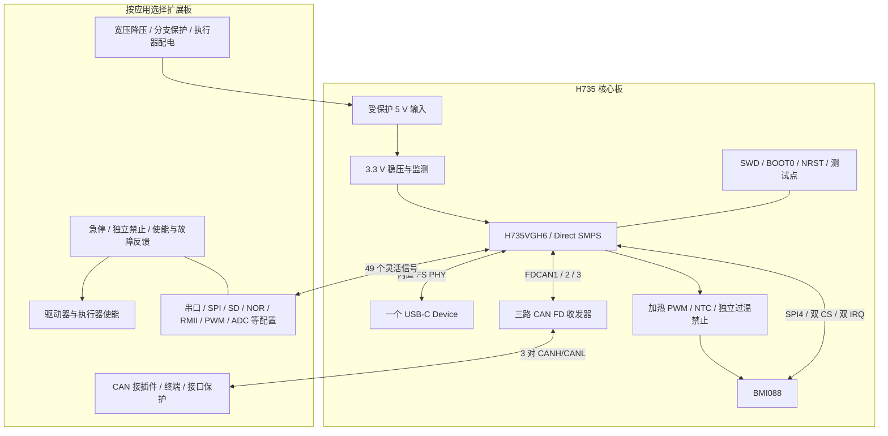

# H735 核心板与扩展板总体规划

> 2026-10-16更新：本文件的BASE-DBG按逻辑全集保留；实际五板、39.8 mm外形、电源/机械/MLCC变更以[v0.9.3设计输入](电源机械与40mm布局定版.md)和[紧凑板连接表](紧凑板原理图连接.csv)为准。旧3.3 nF软启动、未定电容/开关、单块大验证板及LSE预留焊盘描述不再用于A1。

> 2026-10-13 补充：时钟/DMA、关键器件和 CORE/BASE-DBG 连接以 [v0.9.1 电气设计基线](时钟DMA与关键器件定版.md) 与 [连接设计](核心板与验证扩展板连接设计.md) 为准；下文未关闭项以该补充的状态更新。AUX 改为500 mA设计目标并增加限流及掉电隔离。
2026-10-13，v0.9 工程规划草案。目标是以一种核心板覆盖 RM 通用控制、多关节协作、网络网关、串口设备和采集验证，用扩展板决定物理接口、电源等级和应用功能。对高实时性、完整 IMU 热设计和可恢复调试优先投入；外围不再为了“可能用到”全部固定在核心板。

## 需求优先级与边界

| 级别 | 规划要求 | 验收方式 |
| --- | --- | --- |
| 必须 | STM32H735VGH6、0.8 mm 球距；至少 480 MHz 工作配置 | 精确封装、供电/VOS、时钟树、温升及运行检查；550 MHz 另做目标档验证 |
| 必须 | 核心三路独立 CAN 控制器及三颗收发器 | 三路实总线同时收发、独立错误计数与故障隔离；多插座不算新增总线 |
| 必须 | BMI088、专用 SPI、双片选、双采样中断 | ID、采样、时间戳、标定、噪声、丢样及姿态测试 |
| 必须 | IMU 加热电路、温度采集及独立过温禁止设计 | 温控及故障实验；固件上线前默认关闭，不再将加热作为可删除功能 |
| 必须 | 一个核心板 USB 数据口 | USB FS Device，12 Mbit/s 物理速率；插拔、反灌、枚举、满负载吞吐测试 |
| 必须 | 核心板独立上电、SWD/BOOT0/NRST 可接近、错误固件可恢复 | 无扩展板时通过调试夹具恢复；执行器使能依赖扩展板独立条件 |
| 必须 | 核心与扩展功能分层，引脚复用有显式配置 | 配置选择同时确定接线、装配、BSP、驱动、时钟/DMA和端口所有权 |
| 优先 | 多 MCU：RS-485 线束链路与同底板 SPI | 同一业务协议和超时状态机，两种传输分别验收 |
| 可选 | TF、NOR、以太网、RS-485、PWM/编码器、模拟前端、指示与蜂鸣 | 扩展板提供；依据所选配置确认并发和电气，不承诺所有功能同时打开 |
| 后续 | 外部 RAM、显示/相机、隔离 CAN 变体、USB Host、自动冗余切换 | 独立资源和硬件评审，不挤占核心必须项 |

“考虑所有应用”按覆盖主要应用类别、保留可重配置资源来落实。当前不把所有协议、电压、功率级与传感器型号装到同一块板上；例如飞行器电源冗余、工业认证、直接驱动多轴裸电机，均需要专用扩展和额外验证。

## 核心板和扩展板的职责

核心板必装 MCU、电源、时钟、BMI088、温控硬件、三路 CAN 收发器、USB 和恢复接口。LSE 可按装配选项保留；指示优先采用不额外占 GPIO 的电源灯及测试点，状态显示由扩展板提供。

TF 卡座、W25Q128、RGB、蜂鸣器、串口差分物理层及执行器电源全部移到扩展板。NOR 可作为短距离扩展板上的四线存储，不能因此宣称核心板无扩展板也有外部存储或 OTA 暂存区。启动与基本恢复依赖片内 Flash/SWD，不依赖可拔扩展板。

核心板与扩展板采用固定机械接口；相同触点始终连接同一个 MCU 焊盘。应用变化改变外设复用和扩展电路，不通过焊桥将触点随机换到不同 MCU 引脚。高速信号避免多个支路并挂；用装配选项实现不同接口时，提供唯一装配表与版本标识。

## 为复用重新安排固定引脚

本轮不沿用 v0.8 的 IMU、CAN2、加热和连接器分配。原因是这些早期固定连接占用了后续高价值外设信号。

| 功能 | v0.9 引脚 | 设计效果 |
| --- | --- | --- |
| CAN1 RX/TX | PB8/PB9 | 保持原分配 |
| CAN2 RX/TX | PB5/PB6 | 释放 PB12/PB13，给 RMII TXD0/TXD1 或 SPI2 留出可能 |
| CAN3 RX/TX | PD12/PD13 | 保持原分配 |
| CAN STB | PD3/PD4/PD7 | 独立控制三路收发器待机 |
| BMI088 SPI4 | PE2 SCK、PE5 MISO、PE6 MOSI | 释放 PA5/PA6/PA7，允许 TIM8 刹车/互补输出、DAC 和 RMII 配置 |
| BMI088 CS | PE3、PE4 | PA4、PA15 不再被 IMU 片选占用，可提供 DAC/SPI3 NSS |
| BMI088 IRQ | PC13/EXTI13、PD10/EXTI10 | 释放 PC4/PC5，允许 RMII RXD0/RXD1、ADC 配置；PC13 仅作输入 |
| 加热 PWM/温度 | PE9/TIM1_CH1、PC3_C/ADC3_INP1 | TIM1 为热管理保留；PC6/PC7 可选择 USART6 或 TIM8 |
| USB | PA11/PA12、PA9 GPIO 检测 VBUS | 一个核心 USB，不引出重复 D+/D− 支路 |
| 本地 5 V 监测 | PC2_C/ADC3_INP0 | 与 NTC 共用 ADC3 调度，但各自独立通道 |

SWD 使用 PA13/PA14；8 MHz HSE bypass 使用 PH0、PH1 保留不接；PC14/PC15 为可选 LSE 保留。合计 28 个固定信号焊盘，其中包含时钟、调试和专用模拟焊盘；其余 49 个信号焊盘全部作为灵活扩展资源。它们不是“49 路可任意同时打开的外设”。电源/系统球位另有 23 个。

## 三路核心 CAN 的具体工程要求

沿用候选 TCAN1042HGVDRBRQ1，三颗独立实例；VCC 5 V、VIO 3.3 V，按精确订货型号/封装复核。核心靠近收发器安装去耦，STB 上拉使复位待机，TXD 默认 recessive；三路分别保留 TX/RX/STB 测试点。H/G/V 的型号差异、FD 速率等级与封装不能省略到一个不确定的“TCAN1042”。[TI TCAN1042H-Q1](https://www.ti.com/product/TCAN1042H-Q1)

核心输出 CAN1_H/L、CAN2_H/L、CAN3_H/L。核心收发器到板间连接器之间预留低电容保护位，外部线束连接器处的扩展板承担主要浪涌/ESD回流和可选择的共模器件。保护器件的电容和钳位电压必须纳入 CAN FD 信号测试，不能用通用高电容 TVS 随意替换。

终端留在扩展板或专用调试转接板，默认不装；每条物理总线只在两端匹配终端。扩展板可将一条 CAN 接到多个插座，但所有插座共享该路控制器、带宽和故障域。电机电源插针和大电流回路完全位于扩展板，核心连接器不承载电机电流。

首轮经典 CAN 1 Mbit/s；FD 先以 1 Mbit/s 仲裁、2 Mbit/s 数据作为试验起点，再根据实际线束、终端和收发器型号验证其他档位。硬件错误、bus-off、过滤器、软件队列和帧龄分别记录；收发器待机不能代替驱动器失联策略。

本版本是非隔离 CAN 核心。只把另一个隔离收发器并接到 CANH/L 不能获得 MCU 与总线的电气隔离。需要隔离时建立独立装配变体：切除对应核心非隔离物理层，通过专用短距离数字接口连接隔离收发器，或使用经验证的隔离 CAN 中继；供电和传播延迟另行评审。默认 100 触点不重复输出全部 CAN 逻辑信号。

## IMU 和温控必须作为一个子系统设计

BMI088 使用 SPI4 独占总线、两根上拉片选、两根中断；传感器电源独立分支去耦。SPI4 从低速读 ID 开始，验证加速度计 dummy byte、陀螺及加速度 ODR、数据新鲜度和坐标方向，再提高速度。双传感器中断并不自动保证同一采样时刻，若应用需要严格同步，按 Bosch 同步方案重新核对信号与配置。[Bosch BMI088](https://www.bosch-sensortec.com/en/products/motion-sensors/imus/bmi088)

IMU 布局在可控热岛，远离 MCU、电感、CAN 收发器和 USB 插拔受力区域；不要把三颗收发器的温升当成可控加热源。评估铜皮热导与固定孔位置，不因开槽切断关键回流。传感器朝向、原点、板安装姿态、标定版本和温度进入设备描述。

加热保留原始预算：5 V 电阻加热，4×200 Ω 并联等效 50 Ω，额定约 0.5 W；输入 5.25 V、阻值 −1% 时约 0.557 W、每只约 0.139 W。1206/0.25 W 只是候选规格，必须结合板温降额。3.3 V 栅极可充分驱动的 N-MOS 由 PE9 PWM 控制，栅极下拉默认关断。

主温度传感器为靠近 IMU 的 NTC，PC3_C 采样，检测开路、短路和不合理温升；与 BMI088 温度交叉检查。独立硬件过温通道采用单独传感器/温控开关，控制另一只加热电源开关，避免主 PWM MOS 短路后软件失去切断能力。温控器、MOS、NTC 的精确型号和阈值需在原理图阶段关闭。

初调可选择约 40°C 的台架设定值，最终按环境最高温度、传感器噪声、温漂和升温能力确定；环境超过设定值时加热不能降温。加入限占空比、积分防饱和、温升速率检查、预热超时和故障锁存；硬件切断阈值要包含 NTC、参考和比较器误差。温度未稳定时对姿态数据加状态标志，不能简单阻塞所有通信等待预热。

加热电路作为必需设计，不再从 BOM 中删除；首次上电仍先断开加热支路，确认测温和独立切断后再使能。这是调试顺序，不能写成“加热永久 DNP”。

## USB 和供电

核心提供一个 USB-C USB2.0 Device，内置 FS PHY，PA11/PA12；CC1/CC2 各自 Rd，D+/D− 短且无分叉，保护靠近接口。VBUS 经带 Ioff 的检测电路送 PA9，不直接接 MCU，不与外部 5 V 硬并。上位接口优先用于配置、日志、协议和维护，不把 USB FS 物理速率当作低抖动实时保证。

首装采用外部 5 V 自供电，USB 只提供数据和检测。需要 USB 单线维护供电时，另装限流与防反灌电源选择，并限制加热、收发器和外供电流；枚举前/后电流及 Type-C 电源规则由完整设计确认，不能直接按“插上电脑就能满功能供电”规划。

核心供电仍为 5V_IN → TPS62132 固定 3.3 V → H735 Direct SMPS。Direct SMPS 的 VDDLDO/VCAP/VFBSMPS 接 VCORE，VLXSMPS 经独立电感形成内核电源。沿用[旧版电源细节](../最小系统与外围规划.md)中的电源拓扑与原厂依据，但该文档的外设引脚及器件归属已被本规划替代。任何供电配置必须与启动文件和 Bootloader 保持一致。

| 支路 | 初始预算或要求 | 后续关闭条件 |
| --- | --- | --- |
| 核心 5 V 总入口 | 1.5 A 设计预算，包含核心自身、加热及约定外供 | 工作模式峰值、启动浪涌、连接器降额与温升 |
| 加热 5 V | 最大约 0.11 A 电阻负载，额外计驱动损耗 | 全占空与故障切断实测 |
| 3V3_AUX | 两触点合计 500 mA 设计目标（待压测） | 外设启动、电压跌落和外部短路保护 |
| 三路 CAN | 按三个精确收发器最大值和总线状态分别计入 | VCC/VIO 上电、dominant、短路与待机电流 |
| 扩展板 PHY、TF、存储及灯 | 优先由扩展板本地供电预算覆盖 | 不得假定 3V3_AUX 能供所有模块 |

双核心按核心入口合计 3 A 预算评审上游，再加扩展板和转换损耗；它是设计容量输入，不是实测功耗。不能并联独立 3.3 V 稳压器输出，也不能由一块板的 3V3_AUX 给另一核心供电。

## 连接器与机械规划

保留两组 50 触点作为逻辑预算，新表输出 49 个 EXP_GPIO、三对 CANH/L、6 个 5V_IN 触点、2 个 3V3_AUX 触点和 37 个地。3V3_AUX 的 500 mA 是合计设计目标，尚未通过热与压测。编号不是旧 v0.8 接口，不允许新旧板混插；量产接口需要防呆、版本标识和独立测流/断电点。

逻辑表按 GPIO 命名保持复用透明，具体扩展板在丝印上标应用接口名。连接器精确系列、接触电流、配对高度和插拔寿命待结构输入；优先评估具有可靠锁定/固定的双排板对板连接器，避免松动的长排针承担高速或振动环境。

核心先以约 35×40 mm 的摆件窗口评估，若热隔离、连接器和保护无法闭合，则放宽到约 40×45 mm；都不是已经布通或冻结的尺寸。优先六层评估完整地参考、BGA 扇出和两条电源回流，0.8 mm 球距不自动保证可用任意板厂通孔工艺。先完成摆件和制造能力核对，再确定是否调整尺寸、层叠或过孔结构。

所有扩展信号仅通过短距离板对板连接，TTL、SPI、I2C 不直接拉到机器人长线束。RMII、SDMMC、Quad-SPI 的连接器通道、回流、串扰和延迟应在物理分配时重新优化；当前按 GPIO 排序的逻辑 CSV 不是可直接布高速线的最终针序。

## 应用扩展板系列

| 扩展板 | 典型对象 | 主要外围 | 首轮优先级 |
| --- | --- | --- | --- |
| BASE-DBG | 开发、教学、调试 | 受保护 5 V、CAN 接头/可拆终端、UART/RS-485、测试点、使能模拟器 | 第一块，先验证核心所有必需功能 |
| BASE-RM | 步兵、英雄、哨兵等通用底盘/云台 | 宽压降压、执行器分支、三 CAN 接插件、遥控/裁判/上位串口、TF、状态指示、独立禁止 | 第二块；电压和电流按实际机器人定 |
| BASE-LINK | 多关节、双 MCU、模块化底盘 | RS-485 差分链路或同底板 SPI、同步/测时点、各板独立供电与禁止 | 与 RM 版共享电路并先做双节点 |
| BASE-MEM | 长时记录、参数/镜像暂存 | TF、W25Q128、供电和插拔控制 | 需要存储的应用装配，不占所有核心的空间 |
| BASE-NET | 网络网关、上位互联、工业研究 | RMII PHY、PHY 时钟/复位、磁性器件/RJ45、网络电源与保护 | 引脚方案已静态检查；协议栈和实时性后续验证 |
| BASE-IO | 工程机器人、串口执行器、采集与教学 | 按端口选择 TTL/RS-485/RS-232、ADC/DAC 前端、PWM/编码器/数字 IO | 按实际设备选装；九串口仅为 TTL 复用配置 |
| BASE-MOTOR | 单轴电机控制研究 | 栅极驱动、桥臂、采样、刹车/过流、功率电源 | 后续专项；不能把逻辑 PWM 板作为已验证电机驱动器 |

不同 RM 机器人类别主要改变端口映射和扩展板负载，不必为每一种机器人重新做核心板。空中、平衡及强耦合机械臂等应用还要单独审查传感器冗余、供电、控制延迟和失联后的机械行为；当前规划不等于赛事规则符合性认证。

## 多 MCU 协作方式

跨部位优先 UART4 + THVD1450，PD1 TX、PD0 RX、PD15 DIR。它占设备串口但保留每板三 CAN。先验证两节点 3 Mbaud/500 Hz，再试 6 Mbaud/1 kHz；真实波特率与所选时钟树一起确认。

同底板 SPI3 使用 PB3 SCK、PB4 MISO、PB2 MOSI、PA15 NSS，PB1 READY，双板配置可加 PA5 SYNC。固定核心 IMU 改用 SPI4 后，不再与这些信号争用。主机片选可配置为 GPIO，从机用硬件 NSS；角色、上电顺序和 DMA 准备通过状态机控制。

两块核心分别处理本地采样、执行器反馈与闭环，协调节点统一模式、控制权和耦合计算。周期目标带会话、序号、生效时间、有效期限和 CRC；目标、配置和日志使用独立有界队列。通信恢复后重新握手、清旧队列并显式使能，不首发双链路自动接管。

沿用[多 MCU 协作分析](../共性研究/H735多MCU协作与验证方案.md)的协议、带宽和故障验证方法，但其 v0.8 SPI 改线建议、SPI1 IMU 和原连接器编号已被本目录覆盖。以太网扩展也不自动变成 EtherCAT 从站，后者需要额外从站控制器或适用实现与协议验证。

## 当前结论

核心板固定的是三 CAN 物理接口、完整 IMU 温控、一路 USB 和可靠最小系统；扩展板决定设备物理层、存储、网络、控制 IO 与功率。新引脚让这些核心功能在所有已列配置中保留，并使 RMII、TIM8、九路 TTL 串口等成为有明确代价的可选配置。

下一步依据[实施与验收矩阵](实施步骤与验收矩阵.md)先关闭时钟/DMA与正式原理图输入，不以静态校验通过代替可制造设计。最终资源数量及可用条件见[片上与外围资源汇总](片上与外围资源汇总.md)。
