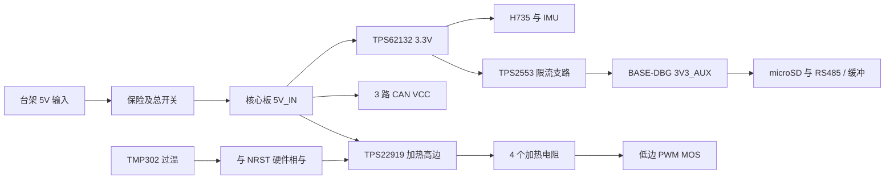

# 核心板与 BASE-DBG 原理图连接设计

> 2026-10-16更新：本文件的BASE-DBG按逻辑全集保留；实际五板、39.8 mm外形、电源/机械/MLCC变更以[v0.9.3设计输入](电源机械与40mm布局定版.md)和[紧凑板连接表](紧凑板原理图连接.csv)为准。旧3.3 nF软启动、未定电容/开关、单块大验证板及LSE预留焊盘描述不再用于A1。

2026-10-13，v0.9.2-design（连接器/485更新；时钟沿用v0.9.1）。本轮对象为核心板 + 通用台架验证扩展板 BASE-DBG。默认装配/固件为 **RM_STANDARD**，同底板 SPI 验证使用主/从装配选项；跨线束使用 UART4/RS-485。机器可读的逐引脚连接见 [原理图连接.csv](原理图连接.csv)，逐针角色见 [应用配置引脚.csv](应用配置引脚.csv)。这些是画图输入，尚不是 EDA 工程或经过 ERC 的网表。

## 1. 页划分与电源域

| 页 | 原理图内容 | 上电状态 |
| --- | --- | --- |
| C01 | U1 100 球、Direct SMPS、VDD/VDDA/USB/VBAT | 按 MCU 供电时序，VCORE 禁止接 3.3 V |
| C02 | 5V→3V3 buck、AUX 限流、测试点 | AUX 上电使能，故障锁断；可手动复位 AUX |
| C03 | HSE、NRST supervisor、BOOT、SWD | BOOT0=0；NRST 由监控释放；HSE bypass |
| C04 | BMI088、NTC、加热、硬件温控 | PWM 下拉、复位强制关高边；独立过温断电 |
| C05 | 三路 TCAN1042、STB、CAN TVS | STB=1、TXD=1，直到自检后开启 |
| C06 | USB-C、VBUS 检测、ESD | 自供电，未检测到 VBUS 不连接 Device |
| C07 | J1/J2 100 触点、49 flexible GPIO | 无应用固定拉阻；由扩展板定义 |
| B01 | 5 V 台架输入、保险/开关、CORE 配合座 | 禁止接机器人电池/24 V |
| B02 | 三路 CAN 端子、终端与可选线端保护 | 终端默认断开，按总线端点装配 |
| B03 | 四路 RS-485/TTL 选择、遥控/主机串口 | DIR=0 接收；外部输入有掉电高阻缓冲 |
| B04 | SPI 主从选择、READY、I2C 与 GPIO 测试 | 两端角色互补，所有选择断电操作 |
| B05 | microSD、四路 PWM、模拟电位器/测试口 | 电机功率器件不装；默认只连接仪器或假负载 |
| B06 | ESTOP 回路、PWR_EN 硬件门控、5 V 假负载 | 急停断线或 PWR_EN=0 → 负载失电 |

BASE-DBG 使用受限的台架 5 V，不承担宽压机器人母线、超级电容、再生能量、电机大电流回路。输入要求 **板上 5V_IN 保持 4.75–5.25 V**；建议可调限流实验电源，首次 0.2 A 逐步增加，完整负载按核心 1.5 A 预算检查。没有从 USB VBUS 给整板供电的路径。5 V 输入端用带极性两针端子、总开关、2 A 保险焊位（具体保险须配合线束/入口保护签核）；电源方向标记并做反接台架限流验证，当前不能宣称自带反接保护。设计中无电池/24 V 接口。

## 2. 核心板逐网连接

### 2.1 MCU 与电源

完整 100 球以 [100球连接规划.csv](100球连接规划.csv) 为准，以下是不能遗漏的系统网。

| U1 引脚 | 连接 |
| --- | --- |
| VDDSMPS E1 | 3V3；近端 10 µF +100 nF |
| VLXSMPS D2 | → 2.2 µH L1 → VCORE；开关节点到 GND 220 pF C0G，按 ST 推荐布局 |
| VFBSMPS E2 | 从 VCORE 电容端 Kelvin 回授，不能取开关端 |
| VSSSMPS D1 | 功率回流地；最短回路，不穿过 IMU 区 |
| VCAP D8/G6；VDDLDO E6/F7 | 全接 VCORE；两只 10 µF 输出电容，VCAP 各 100 nF；禁止再按 LDO 模式把 VDDLDO 接 3.3 V |
| VDD D6/E5/F6 | 3V3，各 100 nF，另 4.7 µF；全部焊盘接齐 |
| VSS C1/D5/E7/F5 | GND 连续平面 |
| VDDA H1 / VREF+ J1 / VSSA H2 | 3V3 经 0 Ω 到 3V3_A；VDDA/VREF+ 各 1 µF+100 nF；VSSA=GND；关闭 VREFBUF |
| VDD33USB E8 / VBAT C2 | 3V3，各 1 µF+100 nF；首版无电池 |
| PDR_ON D3 / BOOT0 A5 | PDR_ON=3V3；BOOT0 10 kΩ 下拉、手动短接 3V3 |
| NRST F2 | 10 kΩ 上拉+100 nF 到地、按钮、SWD、TPS3808 RESET 开漏 |

TPS62132RGTR：10/11/12=5V_IN；13 EN=5V_IN；1/2/3 SW→2.2 µH L2→3V3；14 VOS 从输出 Kelvin；5 FB/6 AGND/7 FSW/8 DEF=GND；9 SS 接 3.3 nF；4 PG 100 kΩ 上拉 3V3 并测试点；15/16/EP=GND。输入 10 µF+100 nF，输出 22 µF；布板后核对有效电容、输出纹波、启动与热裕量。

TPS2553DBVR-1：1 IN=3V3、2 GND、3 EN=10 kΩ 上拉3V3（按钮拉低用于 AUX 恢复）、4 FAULT=本地测试点并10 kΩ上拉3V3、5 ILIM=45.3 kΩ 1%到GND、6 OUT=3V3_AUX；输入1 µF+100 nF，输出10 µF+100 nF。**3V3_AUX 不与外部 3.3 V 并联。**500 mA是扩展设计负载，不是限流阈值；阈值有容差且略高。

### 2.2 时钟、复位、下载

X1G004171001500：1 ST=3V3，2 GND，3 OUT→22 Ω→PH0/G1，4 VCC=3V3+100 nF；PH1 留空，不能接晶体负载电容。PC14/PC15 仅保留 LSE 晶体及两电容 DNP，两个网独立；首版不装且不作应用 GPIO。

TPS3808G33DBVR（**DBV 脚号，不能套 DRV**）：1 RESET→NRST，2 GND，3 MR 10 kΩ 上拉3V3并按钮到GND，4 CT 悬空，5 SENSE=3V3，6 VDD=3V3+100 nF。SWD 可直接开漏拉 NRST；复位按钮可作用于 MR，避免两个按钮名字混淆。

SWD 10针：1 VTref=3V3（只参考）；2 SWDIO PA13；3 GND；4 SWCLK PA14；5 GND；6 SWO=NC（PB3 已作 SPI3）；7 Key=NC；8 NC；9 GND；10 NRST。BOOT0 跳帽默认开路。保留 SWD、BOOT0、NRST、3V3、VCORE、5V_IN 测试点；不可把调试器供电与主输入短接。

### 2.3 IMU 与加热

BMI088：3 VDD/11 VDDIO=3V3_IMU（3V3 经0 Ω分支，各100 nF，分支1 µF）；2 NC、4 GNDA、6 GNDIO、7 PS 均接 GND（这里的 NC2 按原厂要求接地）；8 SCK→PE2 经22 Ω；9 SDI→PE6 经22 Ω；10 SDO2 与15 SDO1→PE5 共用 MISO；14 CSB1→PE3；5 CSB2→PE4，CS各10 kΩ上拉；16 INT1→PC13，12 INT3→PD10；1 INT2/13 INT4 不接。ACC/GYRO 共用 MISO 依赖未选中器件三态，禁止双选。起步GYRO ODR=1 kHz，ACC ODR=800 Hz；两路保留独立时间戳，1 kHz控制任务不能把ACC重复样本当新样本。需要更高加速度更新率时改1600 Hz并重新验证调度/滤波。

加热回路：5V_IN→TPS22919 OUT `HEAT_5V`→四个200 Ω并联→`HEAT_DRAIN`→DMN2056U-7 D；MOS S=GND、G 经100 Ω接PE9，G-S 100 kΩ下拉。SOT23 引脚按原厂图：1 G、2 S、3 D。不要用 MOS 阈值电压证明3.3 V驱动能力；本料号给出了2.5 V Rds(on)条件。

TMP302ADRLR：1 TRIPSET0=GND，2 GND，3 OUT=`TEMP_OK`，4 HYSTSET=3V3，5 VS=3V3+100 nF，6 TRIPSET1=3V3；TEMP_OK 10 kΩ上拉3V3。这样名义 **60°C 断开，50°C 恢复**，动作误差按原厂 ±2°C 边界另叠加安装热梯度。

SN74LVC1G08DBVR：1 A=TEMP_OK、2 B=NRST、3 GND、4 Y=`HEAT_ALLOW`、5 VCC=3V3+100 nF。HEAT_ALLOW 100 kΩ下拉；TPS22919DCKR：1 IN=5V_IN、2 GND、3 ON=HEAT_ALLOW、4 NC、5 QOD经1 kΩ到6 OUT=HEAT_5V，输入1 µF、输出100 nF。独立高边不随20 kHz PWM切换；过温或复位才关闭。

该硬件能在 MCU 卡死或低边 MOS D-S 短接时按温度切断加热；**它有回差自动恢复，不是硬件锁存，也不覆盖温控芯片自身失效/脱焊。**固件正常时遇过温/NTC异常/IMU丢失必须锁住加热故障，人工清除。温控芯片贴近加热电阻/IMU热岛，最热电阻与传感器之间的温差必须热像验证，不能只看芯片规格就认定最高板温60°C。

NTC：3V3_A→10 kΩ 0.1%→NTC_NODE→NTCG163JF103FT1→GND；NTC_NODE→1 kΩ→PC3_C，ADC侧10 nF到GND。开路读高、短路读低均禁止加热。5 V检测：5V_IN→20 kΩ 0.1%→V5_NODE→10 kΩ 0.1%→GND，V5_NODE→1 kΩ→PC2_C，ADC侧10 nF；5.25 V时约1.75 V。ADC3统一640.5 cycle采样，12 MHz下四rank约0.22 ms，足够100 Hz扫描。温控目标先40°C、软件50°C停热；环境已高于目标时只能关加热，不能制冷。

### 2.4 三路 CAN

每路 TCAN1042HGVDRBRQ1：1 TXD→MCU TX（10 kΩ到3V3）；4 RXD→MCU RX；3 VCC=5V_IN+100 nF；5 VIO=3V3+100 nF；2/EP=GND；6 CANL/7 CANH→接口；8 STB→对应GPIO，10 kΩ上拉3V3。第一路PB9/PB8/PD3；第二路PB6/PB5/PD4；第三路PD13/PD12/PD7。

PESD2CANFD24V-T：1→CANL、2→CANH、3→GND，靠近核心连接器。底板电缆口保留同器件DNP位置，以线端放电路径和总线电容测试决定是否装；双重TVS不是默认越多越好。核心不固定120 Ω终端。共模电感首版不装，采用直连/0 Ω，不留下断路。

### 2.5 USB

Type-C A6/B6汇合DP、A7/B7汇合DM，靠接口汇合后走一对线；PA12=DP、PA11=DM。USBLC6-2SC6：2 GND、5=USB_VBUS，1↔6保护DP、3↔4保护DM，按原厂flow-through走线；必要串阻留0 Ω焊位，不能默认叠加22 Ω而不检查MCU内部阻抗。USB_VBUS到GND 100 nF；与5V_IN无连接。

CC1=A5、CC2=B5，各自5.1 kΩ 1%到GND，不能合并；所有VBUS触点同网，所有GND触点接GND；SBU不接。屏蔽壳首版仅0 Ω到GND；未装配的RC接地不计入当前连接表。SN74LVC1G17DBVR：1 NC、2 A接VBUS经1 kΩ且A端100 kΩ下拉、3 GND、4 Y→PA9、5 VCC=3V3+100 nF。利用其5.5 V输入容限和Ioff，避免VBUS直达MCU。USB采用软件VBUS感知；没有VBUS则保持disconnect，移除VBUS后停止端点并断开pull-up。

## 3. BASE-DBG 逐接口定义

J1/J2 的1–50已映射为Samtec实际针号，核心TFM在底面、底板SFM在顶面。准确料号、焊盘尺寸、不同器件面编号方向及6.30 mm插合高度见[v0.9.2连接器定版](连接器与RS485保护定版.md)，按[实体针序表](板间实体针序.csv)建库。

### 3.1 CAN、RS-485 与外部串口

CAN端口统一3针：1 CANH、2 CANL、3 GND，三路分开。每路终端为 H→60.4 Ω→SPLIT→60.4 Ω→TERM_L，通过跳帽 TERM_L→L；SPLIT经4.7 nF到GND。跳帽移除不会留下H-L直流终端；终端默认开路，台架点对点时两端装上。连接电机前确认连接器极性、电压和120 Ω终端分布。

四路THVD1450DR：1 R→对应RX；4 D←对应TX；2 /RE与3 DE同接缓冲后的DIR；8 VCC=3V3_AUX+100 nF、5 GND、6 A、7 B。DIR在MCU侧和收发器侧各10 kΩ下拉；每路TX与DIR通过 **SN74LVC1G125DBVR**（1 /OE=BUS_OE_N、2 A=MCU、3 GND、4 Y=收发器、5 VCC=3V3_AUX）缓冲，使AUX关闭后输入仍可高阻承受MCU电平。外部TTL RX输入各100 kΩ上拉到AUX维持空闲；接收器R经0 Ω选择送到MCU RX；TTL模式时移除这只0 Ω并从外部RX缓冲输出连接，避免两路推挽输出相争。

| 口 | TX/RX/DIR | 默认应用 |
| --- | --- | --- |
| DEV1 | PB14/PB15/PA0 | 电机/传感器台架 |
| DEV2 | PD5/PD6/PA1 | 电机/传感器台架 |
| DEV3 | PD8/PD9/PD11 | 电机/传感器台架 |
| DEV4 | PD1/PD0/PD15 | 多板协作；UART4 双向 DMA |

RS-485线端采用B3B-XH-A(LF)(SN)，1 A、2 B、3 GND；CDSOT23-SM712的1/2/3脚分别接线端A/B/GND；A/B各经CRCW060310R0JNEAHP 10 Ω到THVD1450的6/7脚，芯片侧网名A_IC/B_IC。120 Ω可选终端在线端侧，默认断开；不装外部偏置。每路R新增10 kΩ到AUX，避免发送时RX悬空。保护参考、额定边界及残压实测要求见[v0.9.2定版](连接器与RS485保护定版.md)。

HOST UART8：PE1 TX、PE0 RX；RC UART7：PE8 TX可选、PE7 RX。外部RX各用SN74LVC1G125DBVR接收，输入1 kΩ限流，5.5 V以内逻辑容限，不接受RS232负压或电池电压。RC反相在UART RXINV或外部反相装配二选一，不双重反相。外部TTL接头定义1 GND、2 本板TX、3 本板RX、4 3V3参考（不作为外部负载供电）；外接模块掉电后的反灌需按其输入规格验证，默认台架连接已供电仪器。默认上位机优先使用核心USB。

### 3.2 同底板 SPI

LINK 2×6测试接头逻辑定义：1 SCK、2 GND、3 MOSI、4 GND、5 MISO、6 GND、7 NSS、8 GND、9 READY、10 GND、11 SYNC可选、12 GND。不输出5V或3V3，避免两核心电源短接。线路目标≤10 cm，有连续参考地，不走机器人长线束。

每条SCK/MOSI/MISO/NSS/READY都设置互斥的两条装配路径：MCU→22 Ω→接头（OUT）；接头→SN74LVC1G125DBVR输入、缓冲输出→0 Ω→MCU（IN）。缓冲VCC来自**接收端本地3V3_AUX**，/OE接BUS_OE_N，利用Ioff避免对端上电而本地掉电时回灌。OUT和IN不能同时装。

| 角色 | OUT装配 | IN装配 |
| --- | --- | --- |
| Master，默认 | PB3 SCK、PB2 MOSI、PA15 NSS | PB4 MISO、PB1 READY |
| Slave | PB4 MISO、PB1 READY | PB3 SCK、PB2 MOSI、PA15 NSS |

PA15 NSS在MCU侧10 kΩ上拉，PB1 READY 100 kΩ下拉；接头侧NSS另100 kΩ上拉AUX，SCK/MOSI/MISO/READY各100 kΩ下拉，拔线时输入不悬空。MISO只有一个从机时可以单独连接；多从机不能把上述常开输出缓冲直接并联，需与NSS门控或改一对一端口。选装SYNC同样明确方向并加接收缓冲，默认不装。两端固件/装配必须同时记录角色；master在初始化后先NSS高、等待READY、再开始帧。起步固定128 byte全双工帧，包含magic/version/length/node/session/sequence/time/CRC；slave预先准备上一个周期状态，不能要求收到本帧命令后在本帧返回处理结果。5 MHz下线时约204.8 µs/帧，1 kHz占用约20.5%，还需计入帧间隙与调度。

### 3.3 microSD、I2C、PWM 与 ADC

microSD DM3AT-SF-PEJM5：1 DAT2→PC10、2 DAT3→PC11、3 CMD→PD2、4 VDD=3V3_AUX、5 CLK→PC12、6 VSS=GND、7 DAT0→PC8、8 DAT1→PC9；DAT0..3/CMD各10 kΩ上拉AUX；CLK源端22 Ω，其他线0 Ω预留；插座近端10 µF+100 nF。CD开关一端GND，另一端PA4+10 kΩ上拉AUX，软件轮询/消抖，不能占用与其他中断冲突的EXTI4。壳接GND。上述6条SD信号均经过下述双向总线隔离开关，上拉位于SD侧。AUX锁断时硬件先隔离、软件停止SD并将输出置高阻，重新上电后必须重初始化卡；隔离不保证正在写入的文件完整。CLK的22 Ω位于开关输出侧，示波器验证后再调阻值。

I2C2：PB10 SCL、PB11 SDA，各4.7 kΩ上拉AUX（100 kHz起步），接头1 GND、2 3V3_AUX、3 SCL、4 SDA。该接口负载计入500 mA总预算，首版仅接板内/短线3.3 V传感器；400 kHz通过实测rise time选择2.2 kΩ等，不把开漏GPIO当5 V容限自动成立。

四路PWM：PC6/PC7=TIM8_CH1/2，PA2/PA3=TIM5_CH3/4；每路220 Ω→测试口，测试口100 kΩ下拉，默认3.3 V逻辑。舵机电源必须独立，地回路不穿核心；5 V逻辑舵机或驱动器通过专用缓冲板。BASE-DBG不把四路PWM承诺为四个独立频率。

ADC3扩展PC0/PC1：各自测试输入→1 kΩ→MCU，MCU侧10 nF到GND；可以用10 kΩ电位器跨AUX/GND，滑端作为0–3.3 V模拟信号，先验证ADC标定/扫描/NTC通道串扰。两个电位器是**模拟电压/电流输入的仿真源**，不是已经选好的母线电压/电流测量电路。真实机器人母线需重新确定分压量程、采样电阻、放大器、钳位、故障功率与接地。

### 3.4 AUX掉电隔离补充

为避免限流锁断AUX后，核心仍通过SD/I2C或串口输出反向供电，BASE-DBG加入 **SN74CB3Q3245PWR** 双向总线开关和辅助电源监控。VCC=3V3_AUX，芯片掉电有Ioff；它不是5 V到3.3 V电平转换器，所接传感器仍须3.3 V。

PW/TSSOP20：1 NC、10 GND、19 /OE=BUS_OE_N、20 VCC=AUX+100 nF；2↔18、3↔17、4↔16、5↔15、6↔14、7↔13、8↔12、9↔11，依次对应PC8、PC9、PC10、PC11、PD2、PC12、PB10、PB11，左侧MCU、右侧SD/I2C。开关后网名在CSV中用ISO_PC8等表示。所有SD/I2C上拉位于开关后侧。

第二只TPS3808G33DBVR在底板：1 RESET=AUX_READY（10 kΩ上拉AUX、100 kΩ下拉地），2 GND，3 MR=AUX，4 CT悬空，5 SENSE=AUX，6 VDD=AUX+100 nF。AUX_READY经100 Ω送PA10，并驱动DMN2056U-7栅极；MOS源极接地、漏极接BUS_OE_N，BUS_OE_N以10 kΩ上拉AUX。正常延时完成后MOS拉低/OE，允许总线；AUX欠压时先释放/OE，使总线高阻；完全失电时由器件Ioff阻断。全部SN74LVC1G125缓冲也使用这一/OE，不再直接接地，避免上电过程中主动驱动。掉电斜率、监控响应与寄生供电仍需示波器验收。

芯片引脚依据：[TI RevB引脚图](https://www.ti.com.cn/document-viewer/cn/SN74CB3Q3245/datasheet)；电气依据：[TI数据手册](https://www.ti.com/lit/ds/symlink/sn74cb3q3245.pdf)。新增开关约1 mA典型，计入逻辑40 mA预算。

### 3.5 急停与独立禁能验证

PE10 PWR_EN 10 kΩ下拉。BASE-DBG用常闭急停回路：AUX→外部NC触点→ESTOP_N，ESTOP_N 10 kΩ下拉到GND并接PA8。正常闭合为高，按下或断线为低。用SN74LVC1G08DBVR将 PWR_EN 与 ESTOP_N 相与，输出100 kΩ下拉，驱动另一只TPS22919的ON；该开关仅输出到5 V假负载端子，测试负载50 Ω≥1 W（约100 mA）。急停门控不经过MCU软件。

PA10 PWR_GOOD 接下述 AUX_READY，PB7 BASE_FAULT_N 在底板10 kΩ上拉AUX、100 kΩ下拉GND，测试按钮可将BASE_FAULT_N拉低；AUX失电时两者回落。PWR_GOOD 监控辅助3.3 V，不等价于5 V窗口检测；5 V由核心ADC3/台架仪器检查。软件收到PA8/PB7故障后禁能、停止目标调度并锁住故障。外部实际电机若由CAN控制，断开这个假负载输出不会停止电机，必须有驱动器使能/电源断路器的独立安全链；RM应用扩展板另行设计。

## 4. 应用互斥与遗漏复查

BASE-DBG的本轮完整接线只对应CORE_BRINGUP、RM_STANDARD和主从角色变体DUAL_SPI。其余四套配置的引脚/DMA规划通过静态检查，但不表示可直接装在这块底板上运行。MEMORY_LOGGER、NETWORK_GATEWAY、SERIAL_IO、MOTOR_LAB需要移除互斥负载/转接板或专用扩展板并另做接线检查；禁止仅换固件就开启与当前底板不同的AF。

| 检查项 | 本轮结果 / 处理 |
| --- | --- |
| 三CAN + IMU + USB +加热 | v0.9核心28个信号不变，49个扩展引脚不被新增温控/复位电路占用 |
| EXTI13/10、8/7/1 | 编号无冲突；10/13同IRQ向量需共同服务；PA9 VBUS采用轮询 |
| ADC3与DMA | 已核对DMAMUX1 request115；DMA2 Stream0固定，不占用SPI4流 |
| ADC专用模拟脚 | PC2/PC3开关必须OPEN；ADC3 rank依配置，不能把PC1既作ETH_MDC又采模拟 |
| FDCAN RAM | 三路offset不同、容量计算有余量，禁止复制0offset |
| SPI3 JTAG复用 | PB3/PB4/PA15使用SPI，仅保留PA13/PA14的SWD；无SWO/JTAG承诺 |
| NOR / RMII / UART / PWM | NOR与I2C2、DEV3_DIR、PWM_B2等互斥；RMII与DIR/PWM/BASE_CURRENT互斥；SD与UART5/TIM8_CH3互斥；使用七套独立配置，禁止全部同时装配连接 |
| SPI同底板两端掉电 | 增加接收端Ioff缓冲与IN/OUT装配矩阵；单端掉电验证仍必做 |
| RS-485 DE时序 | DMA TC只表示内存送完；必须等待UART TC后再撤DE，接收留turnaround guard；不是DMA完成立即转收 |
| 辅助电源不足 | 200 mA修改为500 mA设计目标，增加独立限流，统一供电避免双3.3 V并联 |
| 加热单点失控 | 新增独立温控+高边断电；明确自动恢复行为和不能覆盖的温控自身故障 |
| 复位电源 | 新增TPS3808；新增器件均不占额外MCU GPIO；BOOT/SWD/NRST测试通路保留 |
| USB回灌与身份 | 自供电Device、VBUS仅感知、两个CC独立下拉；USB接口机械库仍待签核 |
| 终端/偏置/保护 | CAN与485终端可选；RS485线口TVS、浪涌和隔离等级未完成，不作为比赛线束已合格产品 |
| 功率与机械 | v0.9.2已核对连接器实际针序/高度；电感/MLCC降额、EDA封装建库、板轮廓/装配、IMU热梯度/振动仍是投板门槛 |

## 5. 验证顺序与通过条件

1. **数字审查**：运行引脚、时钟/DMA和连接检查。由EDA逐球复核CSV→symbol→footprint，生成真实网表后再对比；0个未解释ERC错误。所有DNP/NC有原因；核心电源、100触点及主从角色两人交叉复核。当前尚未执行EDA步骤。
2. **电源/复位**：不装核心先验BASE连通；分阶段焊接buck/MCU/外设。记录5V、3V3、VCORE启动波形、纹波及NRST。AUX用电子负载0→500 mA，验证锁断/复位；峰值不使主3V3掉出MCU允许范围。短路支路不能引发非预期加热/执行输出。测试完成才允许标示500 mA输出能力。
3. **时钟/内存**：读回RCC/PWR/FLASH/option bytes，与JSON逐项比对；用定时器输出或GPIO测频检查HSE/CPU派生时钟；跑SRAM/ECC初始化检查。所有DMA buffer在规定AXI区域；故意用DTCM地址的开发版断言应拒绝。
4. **核心传感器**：确认两个BMI088身份、各CS和IRQ，记录GYRO 1 kHz、ACC 800 Hz下各自DRDY→DMA完成最大延迟和遗漏。加热从限功率25%开始，逐步50/100%；NTC开路/短路、IRQ停止、MCU暂停、PE9固定高、低边MOS模拟短路都应进入规定关断行为。独立过温通道用外部加热/温箱验证58–62°C动作区间，并测最热器件温差；不能只读NTC自证温控。
5. **三CAN同时**：先内部loopback，再每路外部双节点，各设正确终端。逐步提高流量，测试ID过滤、message RAM边界、FIFO满、拔线、bus-off和恢复。台架目标每路≤60%持续总线占用，1小时序号无缺口/溢出/内存破坏；故障注入另计，不把恢复后的累计错误清零掩盖。
6. **RS-485**：UART4先1 Mbit/s后3 Mbit/s；0.3/1/2 m线束、2/4节点。起步每节点命令32 byte+状态32 byte、4节点500 Hz：纯串行约853 µs/2 ms，再预留8×10 µs方向保护，约47%占用。实际帧变长/节点增多重新预算。测试CRC错误、丢帧、乱序、节点重启session改变和主控断电；从控在超时后本地降级。默认10 ms无有效新目标→禁能是台架值，真实机构制动/抱闸策略按机械风险制定。
7. **SPI双板**：5→10 MHz，各1小时，128 byte固定帧；验证READY延迟、NSS短帧、DMA错误、CRC/session、单端掉电与重新同步。所有故障结束后无需重启全系统即可重新建立会话，但不自动恢复执行使能。目标正常工况1 kHz事务在周期内完成，测量最坏延时；没有实测前不宣称微秒级跨板同步精度。
8. **并发压力**：三CAN+IMU+SPI/485+USB+TF写入同时运行，连续1小时，再高温/低温条件复测。初始退出目标控制任务WCET<周期70%、零deadline miss、DMA/SD/USB缓冲无破坏；记录IRQ最坏延迟、CPU负载、栈余量、TF写入最长阻塞、温度和电源压降。日志队列满可丢日志并计数，不能阻塞电机/IMU任务。
9. **生产前门槛**：确定MCU硅版本与ES0491适用项；完成PCB回流路径、SD/SPI阻尼、CAN/485抗扰、接口反接/单端掉电、连接器振动与加热温差测试；确认关键器件可采购的准确封装。当前阶段不输出Gerber或生产BOM。

检验依据补充：[DM3AT引脚图](https://www.hirose.com/en/product/document?documentid=D49662_en&documenttype=Catalog&lang=en&series=DM3)、[Samtec配对器件](https://www.samtec.com/products/tfm-125-02-l-d-a-tr)、[CAN TVS引脚](https://assets.nexperia.com/documents/data-sheet/PESD2CANFD24V-T.pdf)、[DMN2056U](https://www.diodes.com/datasheet/download/DMN2056U.pdf)、[SN74LVC1G125](https://www.ti.com/lit/ds/symlink/sn74lvc1g125.pdf)。芯片基础来源与时钟依据见 [定版文件](时钟DMA与关键器件定版.md)。
