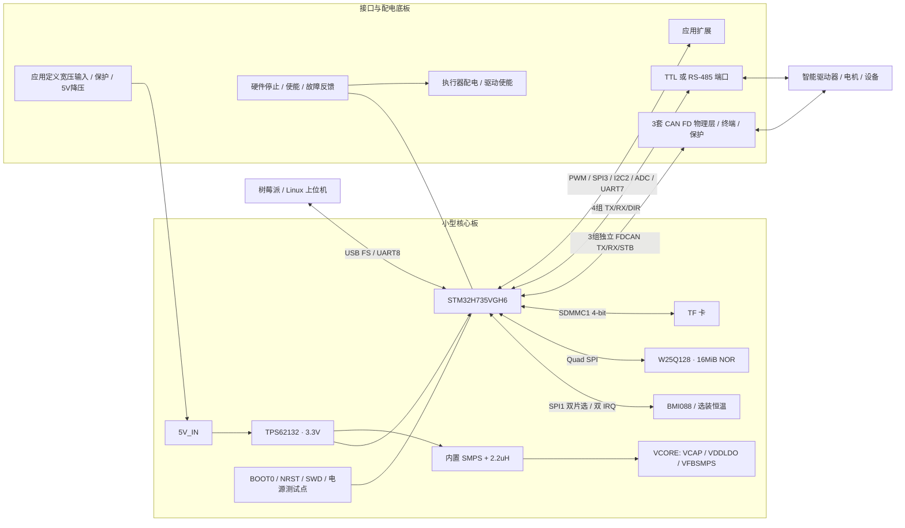

# H7MS-Core-A1 硬件架构

2026-10-11。已选择的设计方案，尚非实物架构验收结果。

## 电源与恢复

外部 5 V、3.3 V IO 和约 1.x V 内核是三个不同网络；SMPS_SW 是开关节点。Direct SMPS 模式下内部 LDO 关闭，VDDLDO 接 VCORE。USB 首装自供电，VBUS 仅用于检测；可选 USB 维护供电需通过限流和反向阻断路径，不能直并外部 5 V。

电机大电流不流经核心板。默认 PWR_EN=0、CAN 待机、UART DIR=0、PWM/加热关闭。急停状态由 MCU 读取用于记录，但底板禁止路径须独立影响执行器使能；这份架构还不构成安全等级认证或已完成的安全电路。

## 占地取舍

MCU 8×8 mm；SMPS 电感 2.5×2.0 mm；3.3 V 稳压器 3×3 mm、其电感初选4×4 mm；NOR 6×5 mm；BMI088 3×4.5 mm。它们的外形面积不可直接相加得到 PCB 面积，仍需去耦、回流、BGA 扇出、传感隔离与连接器空间。TF 和 USB 插座是重要机械约束。

本轮保留所有信号规划；恒温、LSE、RGB/蜂鸣器可以通过 DNP 做装配裁剪。以 [100球表](数据/STM32H735VGH6_100球连接表.csv)及[最小系统规划](最小系统与外围规划.md)作为绘图输入。
