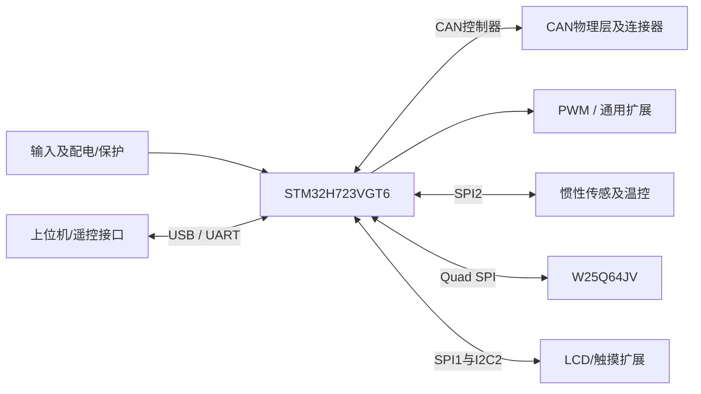

# 达妙DM-MC02 硬件架构

整理：2026-10-11。依据本目录原理图及说明书重建的功能视图；不是厂商原始架构图，也未做实物验证。板卡定位：**当前H735方案的主要功能资源参考**。

| 模块 | 原理图/手册观察 |
| --- | --- |
| MCU | STM32H723VGT6 |
| CAN | 3 路独立原生 FDCAN，各有物理层 |
| IMU | BMI088 双片选/双中断及加热 |
| 存储 | W25Q64JV，8 MiB NOR |
| 通信扩展 | USB FS、2路RS-485及多串口、LCD SPI/I²C、DCMI |
| PWM | 4路PWM（TIM2两路+TIM1两路） |
| 电源 | 12～24V手册范围、受控5V/外设输出；6S电池最高电压需另核 |

## 对本工程的意义

保留三CAN、四设备串口、IMU、PWM和扩展思路；H7MS另用TFBGA100、Direct SMPS、16MiB NOR与TF，既不针脚兼容也不保证LCD/DCMI模块可直接插用。

证据边界：主板V1.0-240124原理图6页、V1.1手册17页；本轮补齐引脚标注图、LCD模块原理图及主板STEP。未获得原生EDA、PCB走线或生产BOM，图纸与手册不是同一修订。

电流额定、共地/隔离、热设计、时序与停止行为需绑定实物和版本；本图不表示这些性能已经验证。详细页码、疑点和采用条件见[总结分析报告](总结分析报告.md)；图纸见[原理图索引](原理图/README.md)，来源见[来源说明](资料/来源说明.md)。
